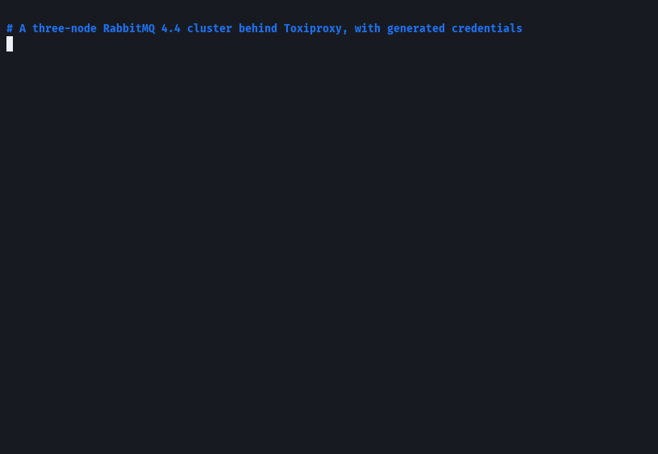
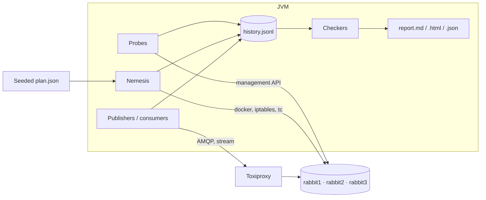

# rmq-verify

[](https://github.com/Andassa/rmq-verify/actions/workflows/ci.yml)
[](https://github.com/Andassa/rmq-verify/actions/workflows/security.yml)
[](LICENSE)

Checks whether messages that RabbitMQ confirmed actually survived a kill, a pause or a network
partition. Publishers and consumers run against a 3-node cluster, faults are injected, and the
recorded history is checked afterwards. The seed fixes the fault plan and the workload. It does
not fix the broker's timing.

## Demo



Recorded from [`docs/demo.sh`](docs/demo.sh) on RabbitMQ 4.4.0, seed 42. The quorum run under
that partition stayed valid. The classic queue with `x-max-length` lost messages, and the
checkers reported it. The raw session is [`docs/demo.cast`](docs/demo.cast)
(`asciinema play docs/demo.cast`).

## Quick start

JDK 21, Docker Compose v2, GNU Make, `openssl`.

```bash
make build
make up          # RabbitMQ 4.4. Use RABBITMQ=3.13 or TLS=1 if you want those.
make demo        # 60 s on a quorum queue, then opens report.html
make down
```

```bash
java -jar rmq-verify-cli/target/rmq-verify.jar run \
  --queue-type QUORUM --consumers 0 \
  --nemesis kill-node,pause-node,partition-halves --duration 120 --seed 7
java -jar rmq-verify-cli/target/rmq-verify.jar check runs/<run>/history.jsonl
java -jar rmq-verify-cli/target/rmq-verify.jar replay --plan runs/<run>/plan.json
java -jar rmq-verify-cli/target/rmq-verify.jar minimize --plan runs/<run>/plan.json --checker LostMessages
```

Exit codes: `0` all checkers valid, `1` a violation, `3` inconclusive, `2` bad usage, `4` tool error.

## Results

<!-- results:start -->
_Generated by `make bench` on 2026-10-24T13:03:44.777787Z (commit `d27bbe6`); details in [RESULTS.md](RESULTS.md)._

Each cell: runs with a violation / repetitions, then the totals over the repetitions.

| Scenario | RabbitMQ 3.13.7 | RabbitMQ 4.4.0 |
|---|---|---|
| `classic-kill` | **0/2** invalid · lost 0 · missing-after-recovery 0 · dup 0 · order 0 · max recovery 3.3 s | **0/2** invalid · lost 0 · missing-after-recovery 0 · dup 0 · order 0 · max recovery 0.0 s |
| `classic-maxlength-control` | **2/2** invalid · lost 6235 · missing-after-recovery 0 · dup 0 · order 6235 · max recovery 0.0 s | **2/2** invalid · lost 8049 · missing-after-recovery 0 · dup 0 · order 8049 · max recovery 0.0 s |
| `quorum-kill-pause` | **0/2** invalid · lost 0 · missing-after-recovery 0 · dup 0 · order 0 · max recovery 0.1 s | **0/2** invalid · lost 0 · missing-after-recovery 0 · dup 0 · order 0 · max recovery 0.5 s |
| `quorum-network` | **0/2** invalid · lost 0 · missing-after-recovery 0 · dup 0 · order 0 · max recovery 0.1 s | **0/2** invalid · lost 0 · missing-after-recovery 0 · dup 0 · order 0 · max recovery 0.4 s |
| `quorum-partitions` | **0/2** invalid · lost 0 · missing-after-recovery 0 · dup 0 · order 0 · max recovery 0.0 s | **0/2** invalid · lost 0 · missing-after-recovery 0 · dup 0 · order 0 · max recovery 0.0 s |
| `stream-kill-partition` | **0/2** invalid · lost 0 · missing-after-recovery 0 · dup 0 · order 0 · max recovery 4.7 s | **1/2** invalid · lost 0 · missing-after-recovery 0 · dup 1 · order 0 · max recovery 1.4 s |

<!-- results:end -->

`classic-maxlength-control` drops confirmed messages on purpose. The other cells are what those
plans produced. Counterexamples and the reading notes are in [RESULTS.md](RESULTS.md).

## Checkers

| Checker | Counts as a violation | Does not |
|---|---|---|
| `LostMessages` | confirmed, never delivered, queue drained | a publish with no confirm (`INFO`) that did not survive |
| `ConfirmedButMissingAfterRecovery` | confirmed before a fault, still unacked at the heal, absent after | messages acked before the heal |
| `DuplicateDeliveries` | a repeat without `redelivered`; a stream entry at two offsets | flagged redeliveries; one offset replayed |
| `UnexpectedMessages` | undecodable, unknown or altered payloads | residue from another run (a note) |
| `FifoOrdering` | two confirmed messages delivered out of order; a confirmed gap | redeliveries; an unconfirmed publish |
| `Availability` | no recovery, or slower than the bound (60 s) | a quiet window during the fault |
| `SplitBrainIndicators` | divergent views after the cluster has settled | divergence while the fault is on |

Definitions: [docs/METHODOLOGY.md](docs/METHODOLOGY.md).

## Layout



One message in flight per publisher, synchronous confirm, no retry. Faults are healed even if
the process dies, and only containers labelled as part of this cluster are touched. After the
heal, a drain reads what is still there. Verdicts are a function of the history, so `check`
can recompute them offline. `minimize` drops faults and load until the failure still shows up.

## Limits

- A valid run only says that this plan, this duration and these repetitions showed no violation.
- Publishes without a confirm are reported as indeterminate, not as losses.
- The three nodes share one machine. The client reaches every node through Toxiproxy, so it is
  not stuck on one side of a partition the way an application would be.

## Make

| Target | What it does |
|---|---|
| `make verify` | format, lint, tests, coverage, ArchUnit, SpotBugs, PIT |
| `make up` / `make down` | start or remove the cluster (`RABBITMQ=3.13\|4.4`, `TLS=1`) |
| `make demo` | one faulty scenario and its HTML report |
| `make chaos` | one pass of the scenario matrix |
| `make bench` | 3.13 and 4.4, then regenerates the table above |
| `make e2e` | three scenarios on a real cluster |
| `make security` | SBOM, Dependency-Check, gitleaks, Trivy |

`make report`, `make mutation`, `make fmt`, `make clean`, `make help` cover the rest.

## Docs

[Architecture](docs/ARCHITECTURE.md) ·
[Methodology](docs/METHODOLOGY.md) ·
[Threat model](docs/THREAT_MODEL.md) ·
[ADRs](docs/adr/) ·
[Extending](docs/extending.md) ·
[Contributing](CONTRIBUTING.md) ·
[Security](SECURITY.md) ·
[Changelog](CHANGELOG.md)

[Apache License 2.0](LICENSE).
