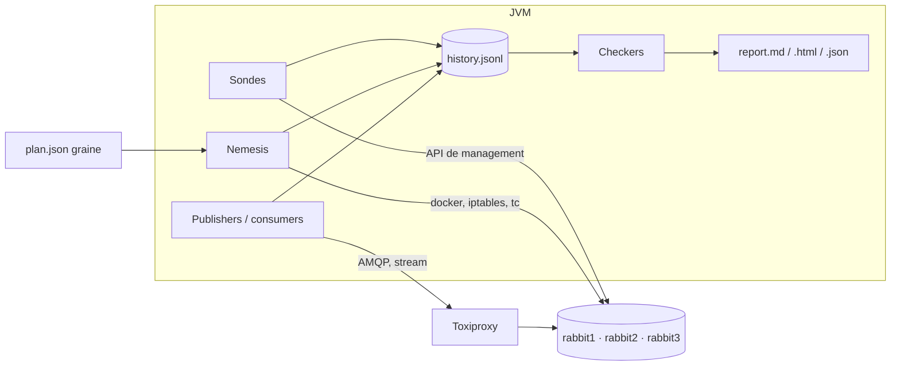

# rmq-verify

[](https://github.com/Andassa/rmq-verify/actions/workflows/ci.yml)
[](https://github.com/Andassa/rmq-verify/actions/workflows/security.yml)
[](LICENSE)

Vérifie si un message confirmé par RabbitMQ est encore là après un kill, une pause ou une
partition. Des publishers et des consumers tournent sur un cluster de 3 nœuds, des fautes sont
injectées, puis l'historique est contrôlé. La graine fixe le plan de fautes et la charge. Elle
ne fixe pas le timing du broker.

## Démo


Enregistrée avec [`docs/demo.sh`](docs/demo.sh) sur RabbitMQ 4.4.0, graine 42. Le quorum sous
cette partition est resté valide. La file classique avec `x-max-length` a perdu des messages, et
les checkers l'ont signalé. La session brute est [`docs/demo.cast`](docs/demo.cast)
(`asciinema play docs/demo.cast`).

## Démarrage

JDK 21, Docker Compose v2, GNU Make, `openssl`.

```bash
make build
make up          # RabbitMQ 4.4. RABBITMQ=3.13 ou TLS=1 si besoin.
make demo        # 60 s sur une file quorum, puis ouvre report.html
make down
```

```bash
java -jar rmq-verify-cli/target/rmq-verify.jar run \
  --queue-type QUORUM --consumers 0 \
  --nemesis kill-node,pause-node,partition-halves --duration 120 --seed 7
java -jar rmq-verify-cli/target/rmq-verify.jar check runs/<run>/history.jsonl
java -jar rmq-verify-cli/target/rmq-verify.jar replay --plan runs/<run>/plan.json
java -jar rmq-verify-cli/target/rmq-verify.jar minimize --plan runs/<run>/plan.json --checker LostMessages
```

Codes de sortie : `0` tous les checkers valides, `1` une violation, `3` non concluant, `2` mauvais
usage, `4` erreur de l'outil.

## Résultats

<!-- results:start -->
_Généré par `make bench` le 2026-10-24T13:03:44.777787Z (commit `d27bbe6`) ; le détail est dans [RESULTS.md](RESULTS.md)._

Chaque cellule : exécutions avec une violation / répétitions, puis les totaux.

| Scénario | RabbitMQ 3.13.7 | RabbitMQ 4.4.0 |
|---|---|---|
| `classic-kill` | **0/2** invalides · perdus 0 · absents après reprise 0 · dup 0 · ordre 0 · reprise max 3.3 s | **0/2** invalides · perdus 0 · absents après reprise 0 · dup 0 · ordre 0 · reprise max 0.0 s |
| `classic-maxlength-control` | **2/2** invalides · perdus 6235 · absents après reprise 0 · dup 0 · ordre 6235 · reprise max 0.0 s | **2/2** invalides · perdus 8049 · absents après reprise 0 · dup 0 · ordre 8049 · reprise max 0.0 s |
| `quorum-kill-pause` | **0/2** invalides · perdus 0 · absents après reprise 0 · dup 0 · ordre 0 · reprise max 0.1 s | **0/2** invalides · perdus 0 · absents après reprise 0 · dup 0 · ordre 0 · reprise max 0.5 s |
| `quorum-network` | **0/2** invalides · perdus 0 · absents après reprise 0 · dup 0 · ordre 0 · reprise max 0.1 s | **0/2** invalides · perdus 0 · absents après reprise 0 · dup 0 · ordre 0 · reprise max 0.4 s |
| `quorum-partitions` | **0/2** invalides · perdus 0 · absents après reprise 0 · dup 0 · ordre 0 · reprise max 0.0 s | **0/2** invalides · perdus 0 · absents après reprise 0 · dup 0 · ordre 0 · reprise max 0.0 s |
| `stream-kill-partition` | **0/2** invalides · perdus 0 · absents après reprise 0 · dup 0 · ordre 0 · reprise max 4.7 s | **1/2** invalides · perdus 0 · absents après reprise 0 · dup 1 · ordre 0 · reprise max 1.4 s |

<!-- results:end -->

`classic-maxlength-control` jette des messages confirmés exprès. Les autres cellules sont ce que
ces plans ont produit. Les contre-exemples sont dans [RESULTS.md](RESULTS.md).

## Checkers

| Checker | Compte comme une violation | Ne compte pas |
|---|---|---|
| `LostMessages` | confirmé, jamais livré, file vidée | un publish sans confirm (`INFO`) qui n'a pas survécu |
| `ConfirmedButMissingAfterRecovery` | confirmé avant la faute, pas acquitté au heal, absent après | messages acquittés avant le heal |
| `DuplicateDeliveries` | une répétition sans `redelivered` ; une entrée de stream à deux offsets | redeliveries marquées ; un offset rejoué |
| `UnexpectedMessages` | payload illisible, inconnu ou modifié | un reste d'une autre exécution (une note) |
| `FifoOrdering` | deux messages confirmés livrés dans le désordre ; un trou confirmé | redeliveries ; un publish non confirmé |
| `Availability` | pas de reprise, ou plus lente que la borne (60 s) | une fenêtre calme pendant la faute |
| `SplitBrainIndicators` | des vues divergentes une fois le cluster stabilisé | une divergence pendant la faute |

Définitions : [docs/METHODOLOGY.md](docs/METHODOLOGY.md).

## Fonctionnement



Un message à la fois par publisher, confirm synchrone, pas de retry. Les fautes sont réparées
même si le processus meurt, et seuls les conteneurs marqués comme faisant partie de ce cluster
sont touchés. Après le heal, un drain lit ce qui reste. Les verdicts sont une fonction de
l'historique : `check` les recalcule hors ligne. `minimize` retire des fautes et de la charge
tant que l'échec est encore là.

## Limites

- Une exécution valide dit seulement que ce plan, cette durée et ces répétitions n'ont rien montré.
- Un publish sans confirm est indéterminé, pas une perte.
- Les trois nœuds sont sur une seule machine. Le client joint chaque nœud via Toxiproxy : il
  n'est pas bloqué d'un seul côté d'une partition, contrairement à une application.

## Make

| Cible | Rôle |
|---|---|
| `make verify` | format, lint, tests, couverture, ArchUnit, SpotBugs, PIT |
| `make up` / `make down` | démarre ou retire le cluster (`RABBITMQ=3.13\|4.4`, `TLS=1`) |
| `make demo` | un scénario avec fautes et son rapport HTML |
| `make chaos` | un passage de la matrice de scénarios |
| `make bench` | 3.13 et 4.4, puis régénère le tableau ci-dessus |
| `make e2e` | trois scénarios sur un vrai cluster |
| `make security` | SBOM, Dependency-Check, gitleaks, Trivy |

`make report`, `make mutation`, `make fmt`, `make clean` et `make help` font le reste.

## Docs

[Architecture](docs/ARCHITECTURE.md) ·
[Méthode](docs/METHODOLOGY.md) ·
[Menaces](docs/THREAT_MODEL.md) ·
[ADR](docs/adr/) ·
[Étendre](docs/extending.md) ·
[Contribuer](CONTRIBUTING.md) ·
[Sécurité](SECURITY.md) ·
[Journal](CHANGELOG.md)

[Licence Apache 2.0](LICENSE).
