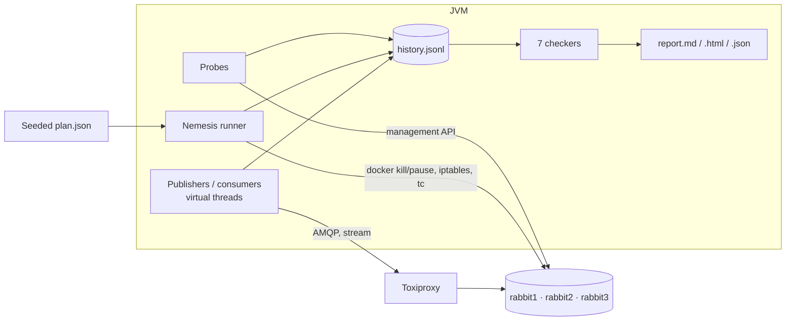

# rmq-verify

[](https://github.com/Andassa/rmq-verify/actions/workflows/ci.yml)
[](https://github.com/Andassa/rmq-verify/actions/workflows/security.yml)
[](LICENSE)

**Jepsen-style verification of RabbitMQ delivery guarantees under faults.**

RabbitMQ documents strong guarantees for publisher confirms, quorum queues and streams, but
nobody can tell from a dashboard whether a confirmed message survived a `kill -9` or a network
partition. rmq-verify runs a seeded workload against a three-node cluster while it kills,
freezes and partitions nodes, records every operation in a history, and then proves or refutes
the guarantees with checkers that only claim what the history can show. Every violation comes
with the exact operations that prove it, and every scenario can be replayed from its seed.

## Results

<!-- results:start -->
_Generated by `make bench` on 2026-10-24T13:03:44.777787Z (commit `d27bbe6`); details in [RESULTS.md](RESULTS.md)._

Each cell: runs with a violation / repetitions, then the totals over the repetitions.

| Scenario | RabbitMQ 3.13.7 | RabbitMQ 4.4.0 |
|---|---|---|
| `classic-kill` | **0/2** invalid · lost 0 · missing-after-recovery 0 · dup 0 · order 0 · max recovery 3.3 s | **0/2** invalid · lost 0 · missing-after-recovery 0 · dup 0 · order 0 · max recovery 0.0 s |
| `classic-maxlength-control` | **2/2** invalid · lost 6235 · missing-after-recovery 0 · dup 0 · order 6235 · max recovery 0.0 s | **2/2** invalid · lost 8049 · missing-after-recovery 0 · dup 0 · order 8049 · max recovery 0.0 s |
| `quorum-kill-pause` | **0/2** invalid · lost 0 · missing-after-recovery 0 · dup 0 · order 0 · max recovery 0.1 s | **0/2** invalid · lost 0 · missing-after-recovery 0 · dup 0 · order 0 · max recovery 0.5 s |
| `quorum-network` | **0/2** invalid · lost 0 · missing-after-recovery 0 · dup 0 · order 0 · max recovery 0.1 s | **0/2** invalid · lost 0 · missing-after-recovery 0 · dup 0 · order 0 · max recovery 0.4 s |
| `quorum-partitions` | **0/2** invalid · lost 0 · missing-after-recovery 0 · dup 0 · order 0 · max recovery 0.0 s | **0/2** invalid · lost 0 · missing-after-recovery 0 · dup 0 · order 0 · max recovery 0.0 s |
| `stream-kill-partition` | **0/2** invalid · lost 0 · missing-after-recovery 0 · dup 0 · order 0 · max recovery 4.7 s | **1/2** invalid · lost 0 · missing-after-recovery 0 · dup 1 · order 0 · max recovery 1.4 s |

<!-- results:end -->

The complete matrix, the counterexamples and the reading guide are in [RESULTS.md](RESULTS.md).

## Quick start

Requirements: JDK 21, Docker with Compose v2, GNU Make, `openssl`.

```bash
make build                       # compile, test-free build of the CLI
make up                          # 3-node RabbitMQ 4.4 + Toxiproxy (RABBITMQ=3.13, TLS=1 available)
make demo                        # 60 s on a quorum queue under kill + partition, opens report.html
make down                        # remove containers, network and volumes
```

Or drive the CLI directly:

```bash
java -jar rmq-verify-cli/target/rmq-verify.jar run --queue-type QUORUM --consumers 0 \
  --nemesis kill-node,pause-node,partition-halves --duration 120 --seed 7
java -jar rmq-verify-cli/target/rmq-verify.jar check runs/<run>/history.jsonl     # offline
java -jar rmq-verify-cli/target/rmq-verify.jar replay --plan runs/<run>/plan.json
java -jar rmq-verify-cli/target/rmq-verify.jar minimize --plan runs/<run>/plan.json --checker LostMessages
```

Exit codes: `0` every checker VALID, `1` a violation, `3` inconclusive, `2` usage, `4` tool error.

## What is checked

| Checker | Violation | Never a violation |
|---|---|---|
| `LostMessages` | a confirmed message is never delivered, although its queue was fully drained | a publish without confirm (`INFO`) that did not survive |
| `ConfirmedButMissingAfterRecovery` | confirmed before a fault, still unacknowledged at the heal, absent afterwards | messages acknowledged before the heal |
| `DuplicateDeliveries` | a repeat without the `redelivered` flag; a stream entry at two offsets | flagged redeliveries; stream replays at one offset |
| `UnexpectedMessages` | undecodable payloads, unknown or altered messages | residue of another run (note) |
| `FifoOrdering` | inversions among first deliveries to a consumer; confirmed gaps before a delivered successor | redelivered messages |
| `Availability` | no recovery, or recovery slower than the bound (60 s by default) | slow windows during a fault |
| `SplitBrainIndicators` | divergent leaders, views or partitions reported after every fault healed and settled | divergence during a fault (note) |

The formal definitions are in [docs/METHODOLOGY.md](docs/METHODOLOGY.md). Each checker is
validated against a simulated correct broker (hundreds of generated histories must be `VALID`,
each injected anomaly must be caught with its evidence) and by mutation testing.

## How it works



1. **Workload**: each publisher sends one persistent, mandatory message at a time and waits for
   its confirm, so every outcome belongs to one message; nothing is retried. Consumers ack
   manually. Streams use the stream protocol.
2. **Faults**: kill, pause, partitions (halves, isolate, bridge), latency, packet loss, client
   toxics, rolling restarts. A safety guard refuses any container that is not labelled as part of
   the test cluster, and every fault is healed, even on crash.
3. **Drain**: after the heal and a settle delay, every queue is emptied with an explicit end
   criterion; that is the ground truth of what survived.
4. **Checks and reports**: verdicts are pure functions of the history, recomputable offline.
   Reports separate what is proven, what is indeterminate and the limits of the run.
5. **Minimisation**: `minimize` shrinks a failing scenario with delta debugging (ddmin) over the
   faults, then reduces the load, using real runs as the oracle.

## Honest limits

- **The seed reproduces the plan and the workload, not the broker.** Elections, retransmissions
  and scheduling vary; scenarios are therefore repeated and results report how many repetitions
  showed each anomaly.
- **A VALID verdict is not a proof of correctness**, only the absence of that anomaly in that run.
- `INFO` publishes (no confirm) are never counted as lost: the grey zone is reported, not hidden.
- Three nodes on one machine; the client sits outside every partition (it reaches all nodes
  through Toxiproxy), which is stronger than an application stuck on one side.
- The control scenario `classic-maxlength-control` loses messages by design (`x-max-length`
  with `drop-head`): it demonstrates detection, it is not a RabbitMQ defect.

## Demo

[`docs/demo.sh`](docs/demo.sh) is a scripted terminal session with a fixed seed. The recording is
[`docs/demo.cast`](docs/demo.cast). Play it with `asciinema play docs/demo.cast`.

Record it again with `asciinema record docs/demo.cast --overwrite -c docs/demo.sh`. A GIF can be
rendered with [agg](https://github.com/asciinema/agg).

## Make targets

| Target | Purpose |
|---|---|
| `make verify` | format, lint, Error Prone, tests, coverage, ArchUnit, SpotBugs/FindSecBugs, PIT |
| `make up` / `make down` | start / remove the cluster (`RABBITMQ=3.13|4.4`, `TLS=1`) |
| `make demo` | one scenario under faults and its HTML report |
| `make chaos` | one pass of the scenario matrix on the running cluster |
| `make bench` | full matrix on 3.13 and 4.4, regenerates `RESULTS.md` and the table above |
| `make e2e` | End-to-end tests on a real cluster, with real faults |
| `make security` | SBOM, OWASP Dependency-Check, gitleaks, Trivy |
| `make report`, `make mutation`, `make fmt`, `make clean`, `make help` | the rest |

## Documentation

[Architecture](docs/ARCHITECTURE.md) ·
[Methodology](docs/METHODOLOGY.md) ·
[Threat model](docs/THREAT_MODEL.md) ·
[Architecture decision records](docs/adr/) ·
[Extending](docs/extending.md) ·
[Contributing](CONTRIBUTING.md) ·
[Security policy](SECURITY.md) ·
[Changelog](CHANGELOG.md)

## License

[Apache License 2.0](LICENSE).
