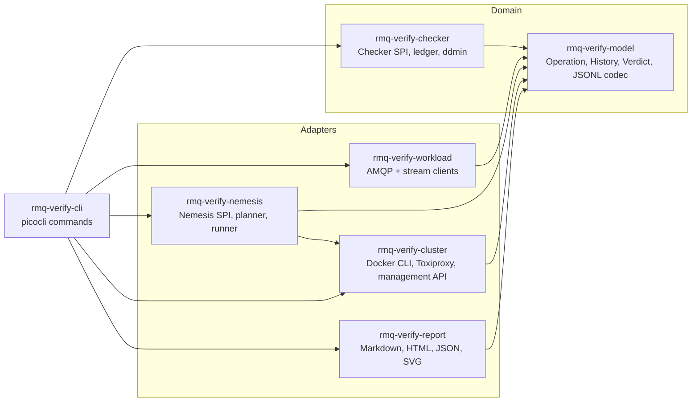
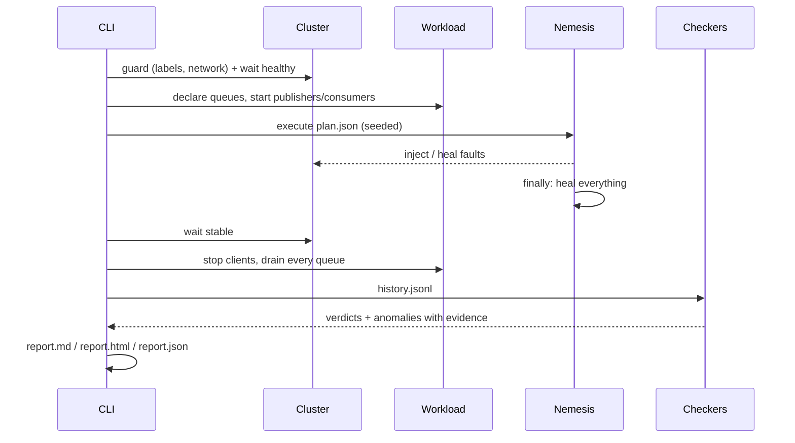

# Architecture

`rmq-verify` follows a hexagonal layout: a pure domain (histories and the checkers that judge
them) sits at the centre, and everything that touches a broker, a container runtime or a file
system lives in adapters around it. The rules below are enforced by ArchUnit tests, not by
convention.

## Modules

| Module | Responsibility | Allowed dependencies |
|---|---|---|
| `rmq-verify-model` | Immutable operations, history invariants, verdicts, JSONL codec | JDK; `jackson-core` only inside `model.jsonl` |
| `rmq-verify-checker` | Checkers (SPI via `ServiceLoader`), message ledger, delta debugging | `model` |
| `rmq-verify-workload` | Seeded publishers and consumers recording operations | `model`, AMQP and stream clients |
| `rmq-verify-cluster` | Cluster control: Docker CLI, iptables, `tc netem`, Toxiproxy, management API | `model` |
| `rmq-verify-nemesis` | Fault SPI, seeded planner, replayable plans, guaranteed healing | `model`, `cluster` |
| `rmq-verify-report` | Rendering of runs and matrices | `model` |
| `rmq-verify-cli` | Wiring and commands (`run`/`replay`, `plan`, `check`, `report`, `minimize`) | everything |
| `rmq-verify-jmh` | Throughput benchmarks of the checkers | `model`, `checker` |
| `rmq-verify-e2e` | Real-cluster scenarios with Testcontainers | everything |

## Run lifecycle

## Key invariants

- The history is append-only. A single recorder assigns identifiers and monotonic timestamps
  under one lock, so the order of the file is the real-time order of the observations.
- Checkers are pure functions of `(History, CheckerContext)`. They never talk to the cluster,
  which makes every verdict reproducible from `history.jsonl` alone (`rmq-verify check`).
- Faults are always healed: the nemesis runner heals in a `finally` block and registers a JVM
  shutdown hook; healing is idempotent.
- No fault is injected before the safety guard has confirmed that every target container carries
  the `io.github.andassa.rmq-verify.cluster` label and sits on the dedicated Docker network.

## Deployment

`deploy/docker-compose.yml` starts `rabbit1..3` (pinned official image plus `iptables` and
`iproute2`, non-root, read-only, only `NET_ADMIN`) and Toxiproxy, on the dedicated network
`rmqv-net`. Clients reach every node through Toxiproxy on `127.0.0.1:25671-25673` (AMQP) and
`127.0.0.1:25551-25553` (streams); management APIs listen on `127.0.0.1:15672-15674`.
`docker-compose.tls.yml` switches clients to TLS. Scripts under `deploy/scripts/` implement
`make up`, `down`, `demo`, `chaos`, `bench` and `security`.

See [METHODOLOGY.md](METHODOLOGY.md) for the formal definitions, [THREAT_MODEL.md](THREAT_MODEL.md)
for the security analysis, [extending.md](extending.md) to add checkers and nemeses, and
[adr/](adr/) for the decisions behind this layout.
