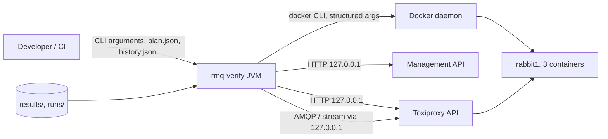

# Threat model

rmq-verify deliberately breaks things: it kills processes, freezes containers and rewrites
firewall rules. The main risk is therefore not an attacker breaking the tool, but the tool
breaking something it was never meant to touch. This document lists the assets, the trust
boundaries, the threats (STRIDE) and their mitigations.

## Assets

| Asset | Why it matters |
|---|---|
| The developer machine and its other containers | The nemesis must never act outside the test cluster. |
| Test cluster credentials (`.env`) | Admin password, application password, Erlang cookie. |
| Histories, plans and reports | They are evidence; tampering would forge or hide anomalies. |
| CI secrets (`NVD_API_KEY`, `GITHUB_TOKEN`) | Used by the security and release workflows. |
| The supply chain (Maven dependencies, container images, actions) | Code that runs with Docker access. |

## Trust boundaries

1. Command line and files → JVM: plans and histories may come from someone else (a bug report).
2. JVM → Docker daemon: whoever controls the arguments controls the daemon.
3. JVM → management API and Toxiproxy: local HTTP with credentials.
4. Repository → CI: workflows, dependencies and images are third-party code.

## Threats and mitigations

| # | STRIDE | Threat | Mitigation |
|---|---|---|---|
| T1 | Tampering, DoS | The nemesis kills, pauses or firewalls a container that is not part of the test cluster (wrong topology, name collision, typo). | `SafetyGuard` checks, before every injection, that the container exists, carries `io.github.andassa.rmq-verify.cluster=rmqv` and `role=node`, and is attached to the dedicated network `rmqv-net`, itself labelled. Node names come only from `Topology`; plans naming other nodes are rejected. Tested in `SafetyAndNetworkTest`. |
| T2 | DoS | A crash or Ctrl-C leaves a node killed, frozen or partitioned. | Heal in `finally` per fault, `healAll()` after the plan, a JVM shutdown hook, and `healAll()` again at the start of every run. Healing is idempotent; `make down` removes everything. |
| T3 | Elevation of privilege | Command injection through container names, proxy names or plan parameters. | No shell anywhere: `ProcessBuilder` with argument lists, only in `SystemProcessRunner` (ArchUnit). Names are validated against `[a-zA-Z0-9][a-zA-Z0-9_.-]{0,62}`; IPs against an IPv4 pattern; netem values are typed numbers. Checkstyle forbids `Runtime.exec`. |
| T4 | Tampering, DoS | A hostile `plan.json` or `history.jsonl` exhausts memory or instantiates arbitrary classes. | Size limits (plan 1 MiB, history lines 64 KiB, 20 M operations), strict schemas rejecting unknown fields, Jackson streaming or record binding only, no polymorphic typing, no Java serialization (Checkstyle + ArchUnit). |
| T5 | Information disclosure | Credentials leak through Git, logs or command lines. | `.env` is generated with random values, mode 600 and Git-ignored; `Credentials` and `BrokerAccess` redact passwords in `toString`; the application password reaches `rabbitmqctl` on stdin; gitleaks runs in CI. The Erlang cookie is visible in process arguments inside the containers (accepted for a disposable local cluster). |
| T6 | Spoofing | Someone on the network uses the test cluster or the management UI. | All published ports bind to `127.0.0.1`; `guest` is restricted to loopback and not created; the application user is limited to `rmqv.*` queues on vhost `rmqv` without management tag. Optional TLS (`make up TLS=1`) with server verification. |
| T7 | Elevation of privilege | A compromised broker container escapes or attacks the host. | Non-root broker process, read-only root file system, `cap_drop: ALL`, only `NET_ADMIN`, `no-new-privileges`, memory and PID limits, dedicated network. Toxiproxy runs as `nobody`. |
| T8 | Tampering | A dependency, image or action is replaced upstream. | Versions pinned in the POM (`requirePluginVersions`), images pinned by digest, Dependabot for updates, OWASP Dependency-Check, Trivy image and configuration scans, CycloneDX SBOM per release. |
| T9 | Repudiation | A result is published without the means to check it. | Every number of `RESULTS.md` comes from `report.json` files generated by `make bench`; compressed histories are archived; `rmq-verify check` recomputes any verdict offline. |
| T10 | Information disclosure | Reports leak data or load third-party content. | Reports are self-contained (no JavaScript, no external URL); data-derived text is HTML-escaped, also in Markdown. Histories contain synthetic payload identities only. |

## Residual risks

- Anyone who can run `rmq-verify` can already drive the local Docker daemon; the tool does not
  protect a machine against its own user.
- TLS mode uses throwaway certificates with unencrypted keys readable by the broker user: it
  validates the TLS code paths, it is not a deployment recipe.
- The safety guard trusts Docker labels; a user who labels a production container `rmqv` on a
  network named `rmqv-net` defeats it deliberately.
