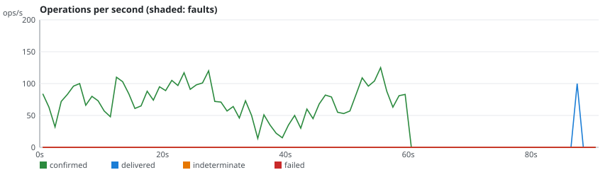
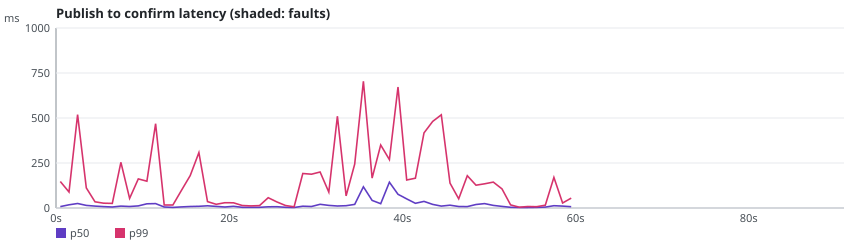

# rmq-verify run r-20261024-112514-2c89

**Overall: INVALID**

| Setting | Value |
|---|---|
| Scenario | classic-maxlength-control (repetition 1) |
| RabbitMQ | 3.13.7 |
| Queue type | CLASSIC |
| Seed | 20262025 |
| Started | 2026-10-24T11:25:21.502589Z |
| Operations | 9268 |
| confirmTimeoutMs | 5000 |
| consumersPerQueue | 0 |
| durationSeconds | 60 |
| maxLength | 100 |
| payloadBytes | 512 |
| publishers | 4 |
| queues | 1 |
| ratePerPublisher | 30.0 |
| settleSeconds | 20 |

## Fault plan

No fault: control run.

## Verdicts

| Checker | Verdict | Violations | Summary |
|---|---|---|---|
| Availability | VALID | 0 | 100.0% of publishes confirmed, longest unavailability 0 ms |
| ConfirmedButMissingAfterRecovery | VALID | 0 | 0 of 0 messages exposed to 0 fault(s) missing after recovery |
| DuplicateDeliveries | VALID | 0 | 0 message(s) delivered more than once out of 4368 |
| FifoOrdering | INVALID | 4268 | 0 inversion(s), 4268 gap(s) over 100 first-time deliveries |
| LostMessages | INVALID | 4268 | 4268 lost of 4368 confirmed; 0 indeterminate (0 survived) |
| SplitBrainIndicators | VALID | 0 | 39 probe round(s), 39 outside fault windows |
| UnexpectedMessages | VALID | 0 | 0 unexpected of 100 deliveries |

## Charts

## Anomalies

### FifoOrdering

- **FIFO_GAP** (VIOLATION): confirmed publisher-2#1034 in rmqv.r-20261024-112514-2c89.classic.0 missing while #1035 was delivered [evidence: #8697 publisher-2 INVOKE PUBLISH @58.728s; #8701 publisher-2 OK CONFIRM @58.740s; #9003 drain:rmqv.r-20261024-112514-2c89.classic.0 OK DELIVER @87.388s]
- **FIFO_GAP** (VIOLATION): confirmed publisher-2#1033 in rmqv.r-20261024-112514-2c89.classic.0 missing while #1035 was delivered [evidence: #8688 publisher-2 INVOKE PUBLISH @58.689s; #8693 publisher-2 OK CONFIRM @58.716s; #9003 drain:rmqv.r-20261024-112514-2c89.classic.0 OK DELIVER @87.388s]
- **FIFO_GAP** (VIOLATION): confirmed publisher-2#1032 in rmqv.r-20261024-112514-2c89.classic.0 missing while #1035 was delivered [evidence: #8678 publisher-2 INVOKE PUBLISH @58.628s; #8683 publisher-2 OK CONFIRM @58.656s; #9003 drain:rmqv.r-20261024-112514-2c89.classic.0 OK DELIVER @87.388s]
- **FIFO_GAP** (VIOLATION): confirmed publisher-2#1031 in rmqv.r-20261024-112514-2c89.classic.0 missing while #1035 was delivered [evidence: #8672 publisher-2 INVOKE PUBLISH @58.542s; #8673 publisher-2 OK CONFIRM @58.556s; #9003 drain:rmqv.r-20261024-112514-2c89.classic.0 OK DELIVER @87.388s]
- **FIFO_GAP** (VIOLATION): confirmed publisher-2#1030 in rmqv.r-20261024-112514-2c89.classic.0 missing while #1035 was delivered [evidence: #8666 publisher-2 INVOKE PUBLISH @58.525s; #8670 publisher-2 OK CONFIRM @58.537s; #9003 drain:rmqv.r-20261024-112514-2c89.classic.0 OK DELIVER @87.388s]
- **FIFO_GAP** (VIOLATION): confirmed publisher-2#1029 in rmqv.r-20261024-112514-2c89.classic.0 missing while #1035 was delivered [evidence: #8658 publisher-2 INVOKE PUBLISH @58.495s; #8663 publisher-2 OK CONFIRM @58.506s; #9003 drain:rmqv.r-20261024-112514-2c89.classic.0 OK DELIVER @87.388s]
- **FIFO_GAP** (VIOLATION): confirmed publisher-2#1028 in rmqv.r-20261024-112514-2c89.classic.0 missing while #1035 was delivered [evidence: #8649 publisher-2 INVOKE PUBLISH @58.449s; #8651 publisher-2 OK CONFIRM @58.463s; #9003 drain:rmqv.r-20261024-112514-2c89.classic.0 OK DELIVER @87.388s]
- **FIFO_GAP** (VIOLATION): confirmed publisher-2#1027 in rmqv.r-20261024-112514-2c89.classic.0 missing while #1035 was delivered [evidence: #8644 publisher-2 INVOKE PUBLISH @58.416s; #8646 publisher-2 OK CONFIRM @58.427s; #9003 drain:rmqv.r-20261024-112514-2c89.classic.0 OK DELIVER @87.388s]
- **FIFO_GAP** (VIOLATION): confirmed publisher-2#1026 in rmqv.r-20261024-112514-2c89.classic.0 missing while #1035 was delivered [evidence: #8622 publisher-2 INVOKE PUBLISH @58.298s; #8626 publisher-2 OK CONFIRM @58.317s; #9003 drain:rmqv.r-20261024-112514-2c89.classic.0 OK DELIVER @87.388s]
- **FIFO_GAP** (VIOLATION): confirmed publisher-2#1025 in rmqv.r-20261024-112514-2c89.classic.0 missing while #1035 was delivered [evidence: #8616 publisher-2 INVOKE PUBLISH @58.249s; #8618 publisher-2 OK CONFIRM @58.266s; #9003 drain:rmqv.r-20261024-112514-2c89.classic.0 OK DELIVER @87.388s]
- **FIFO_GAP** (VIOLATION): confirmed publisher-2#1024 in rmqv.r-20261024-112514-2c89.classic.0 missing while #1035 was delivered [evidence: #8614 publisher-2 INVOKE PUBLISH @58.236s; #8615 publisher-2 OK CONFIRM @58.246s; #9003 drain:rmqv.r-20261024-112514-2c89.classic.0 OK DELIVER @87.388s]
- **FIFO_GAP** (VIOLATION): confirmed publisher-2#1023 in rmqv.r-20261024-112514-2c89.classic.0 missing while #1035 was delivered [evidence: #8610 publisher-2 INVOKE PUBLISH @58.221s; #8613 publisher-2 OK CONFIRM @58.228s; #9003 drain:rmqv.r-20261024-112514-2c89.classic.0 OK DELIVER @87.388s]
- **FIFO_GAP** (VIOLATION): confirmed publisher-2#1022 in rmqv.r-20261024-112514-2c89.classic.0 missing while #1035 was delivered [evidence: #8603 publisher-2 INVOKE PUBLISH @58.182s; #8606 publisher-2 OK CONFIRM @58.194s; #9003 drain:rmqv.r-20261024-112514-2c89.classic.0 OK DELIVER @87.388s]
- **FIFO_GAP** (VIOLATION): confirmed publisher-2#1021 in rmqv.r-20261024-112514-2c89.classic.0 missing while #1035 was delivered [evidence: #8598 publisher-2 INVOKE PUBLISH @58.127s; #8599 publisher-2 OK CONFIRM @58.136s; #9003 drain:rmqv.r-20261024-112514-2c89.classic.0 OK DELIVER @87.388s]
- **FIFO_GAP** (VIOLATION): confirmed publisher-2#1020 in rmqv.r-20261024-112514-2c89.classic.0 missing while #1035 was delivered [evidence: #8581 publisher-2 INVOKE PUBLISH @58.033s; #8584 publisher-2 OK CONFIRM @58.043s; #9003 drain:rmqv.r-20261024-112514-2c89.classic.0 OK DELIVER @87.388s]
- **FIFO_GAP** (VIOLATION): confirmed publisher-2#1019 in rmqv.r-20261024-112514-2c89.classic.0 missing while #1035 was delivered [evidence: #8561 publisher-2 INVOKE PUBLISH @57.948s; #8564 publisher-2 OK CONFIRM @57.968s; #9003 drain:rmqv.r-20261024-112514-2c89.classic.0 OK DELIVER @87.388s]
- **FIFO_GAP** (VIOLATION): confirmed publisher-2#1018 in rmqv.r-20261024-112514-2c89.classic.0 missing while #1035 was delivered [evidence: #8550 publisher-2 INVOKE PUBLISH @57.781s; #8554 publisher-2 OK CONFIRM @57.882s; #9003 drain:rmqv.r-20261024-112514-2c89.classic.0 OK DELIVER @87.388s]
- **FIFO_GAP** (VIOLATION): confirmed publisher-2#1017 in rmqv.r-20261024-112514-2c89.classic.0 missing while #1035 was delivered [evidence: #8541 publisher-2 INVOKE PUBLISH @57.656s; #8544 publisher-2 OK CONFIRM @57.668s; #9003 drain:rmqv.r-20261024-112514-2c89.classic.0 OK DELIVER @87.388s]
- **FIFO_GAP** (VIOLATION): confirmed publisher-2#1016 in rmqv.r-20261024-112514-2c89.classic.0 missing while #1035 was delivered [evidence: #8536 publisher-2 INVOKE PUBLISH @57.620s; #8538 publisher-2 OK CONFIRM @57.632s; #9003 drain:rmqv.r-20261024-112514-2c89.classic.0 OK DELIVER @87.388s]
- **FIFO_GAP** (VIOLATION): confirmed publisher-2#1015 in rmqv.r-20261024-112514-2c89.classic.0 missing while #1035 was delivered [evidence: #8528 publisher-2 INVOKE PUBLISH @57.575s; #8530 publisher-2 OK CONFIRM @57.581s; #9003 drain:rmqv.r-20261024-112514-2c89.classic.0 OK DELIVER @87.388s]
- **FIFO_GAP** (VIOLATION): confirmed publisher-2#1014 in rmqv.r-20261024-112514-2c89.classic.0 missing while #1035 was delivered [evidence: #8525 publisher-2 INVOKE PUBLISH @57.553s; #8527 publisher-2 OK CONFIRM @57.562s; #9003 drain:rmqv.r-20261024-112514-2c89.classic.0 OK DELIVER @87.388s]
- **FIFO_GAP** (VIOLATION): confirmed publisher-2#1013 in rmqv.r-20261024-112514-2c89.classic.0 missing while #1035 was delivered [evidence: #8511 publisher-2 INVOKE PUBLISH @57.515s; #8514 publisher-2 OK CONFIRM @57.523s; #9003 drain:rmqv.r-20261024-112514-2c89.classic.0 OK DELIVER @87.388s]
- **FIFO_GAP** (VIOLATION): confirmed publisher-2#1012 in rmqv.r-20261024-112514-2c89.classic.0 missing while #1035 was delivered [evidence: #8507 publisher-2 INVOKE PUBLISH @57.486s; #8509 publisher-2 OK CONFIRM @57.505s; #9003 drain:rmqv.r-20261024-112514-2c89.classic.0 OK DELIVER @87.388s]
- **FIFO_GAP** (VIOLATION): confirmed publisher-2#1011 in rmqv.r-20261024-112514-2c89.classic.0 missing while #1035 was delivered [evidence: #8502 publisher-2 INVOKE PUBLISH @57.453s; #8504 publisher-2 OK CONFIRM @57.476s; #9003 drain:rmqv.r-20261024-112514-2c89.classic.0 OK DELIVER @87.388s]
- **FIFO_GAP** (VIOLATION): confirmed publisher-2#1010 in rmqv.r-20261024-112514-2c89.classic.0 missing while #1035 was delivered [evidence: #8492 publisher-2 INVOKE PUBLISH @57.362s; #8494 publisher-2 OK CONFIRM @57.378s; #9003 drain:rmqv.r-20261024-112514-2c89.classic.0 OK DELIVER @87.388s]
- ... 4243 more in report.json

### LostMessages

- **LOST_CONFIRMED** (VIOLATION): confirmed message publisher-0#0 in rmqv.r-20261024-112514-2c89.classic.0 was never delivered, queue was drained [evidence: #6 publisher-0 INVOKE PUBLISH @0.046s; #10 publisher-0 OK CONFIRM @0.086s; #9267 drain:rmqv.r-20261024-112514-2c89.classic.0 OK DRAIN @90.786s]
- **LOST_CONFIRMED** (VIOLATION): confirmed message publisher-3#0 in rmqv.r-20261024-112514-2c89.classic.0 was never delivered, queue was drained [evidence: #7 publisher-3 INVOKE PUBLISH @0.051s; #14 publisher-3 OK CONFIRM @0.198s; #9267 drain:rmqv.r-20261024-112514-2c89.classic.0 OK DRAIN @90.786s]
- **LOST_CONFIRMED** (VIOLATION): confirmed message publisher-1#0 in rmqv.r-20261024-112514-2c89.classic.0 was never delivered, queue was drained [evidence: #8 publisher-1 INVOKE PUBLISH @0.051s; #9 publisher-1 OK CONFIRM @0.084s; #9267 drain:rmqv.r-20261024-112514-2c89.classic.0 OK DRAIN @90.786s]
- **LOST_CONFIRMED** (VIOLATION): confirmed message publisher-0#1 in rmqv.r-20261024-112514-2c89.classic.0 was never delivered, queue was drained [evidence: #11 publisher-0 INVOKE PUBLISH @0.112s; #17 publisher-0 OK CONFIRM @0.245s; #9267 drain:rmqv.r-20261024-112514-2c89.classic.0 OK DRAIN @90.786s]
- **LOST_CONFIRMED** (VIOLATION): confirmed message publisher-1#1 in rmqv.r-20261024-112514-2c89.classic.0 was never delivered, queue was drained [evidence: #12 publisher-1 INVOKE PUBLISH @0.117s; #16 publisher-1 OK CONFIRM @0.241s; #9267 drain:rmqv.r-20261024-112514-2c89.classic.0 OK DRAIN @90.786s]
- **LOST_CONFIRMED** (VIOLATION): confirmed message publisher-2#0 in rmqv.r-20261024-112514-2c89.classic.0 was never delivered, queue was drained [evidence: #13 publisher-2 INVOKE PUBLISH @0.143s; #18 publisher-2 OK CONFIRM @0.251s; #9267 drain:rmqv.r-20261024-112514-2c89.classic.0 OK DRAIN @90.786s]
- **LOST_CONFIRMED** (VIOLATION): confirmed message publisher-3#1 in rmqv.r-20261024-112514-2c89.classic.0 was never delivered, queue was drained [evidence: #15 publisher-3 INVOKE PUBLISH @0.205s; #20 publisher-3 OK CONFIRM @0.260s; #9267 drain:rmqv.r-20261024-112514-2c89.classic.0 OK DRAIN @90.786s]
- **LOST_CONFIRMED** (VIOLATION): confirmed message publisher-2#1 in rmqv.r-20261024-112514-2c89.classic.0 was never delivered, queue was drained [evidence: #19 publisher-2 INVOKE PUBLISH @0.255s; #22 publisher-2 OK CONFIRM @0.269s; #9267 drain:rmqv.r-20261024-112514-2c89.classic.0 OK DRAIN @90.786s]
- **LOST_CONFIRMED** (VIOLATION): confirmed message publisher-0#2 in rmqv.r-20261024-112514-2c89.classic.0 was never delivered, queue was drained [evidence: #21 publisher-0 INVOKE PUBLISH @0.260s; #24 publisher-0 OK CONFIRM @0.281s; #9267 drain:rmqv.r-20261024-112514-2c89.classic.0 OK DRAIN @90.786s]
- **LOST_CONFIRMED** (VIOLATION): confirmed message publisher-3#2 in rmqv.r-20261024-112514-2c89.classic.0 was never delivered, queue was drained [evidence: #23 publisher-3 INVOKE PUBLISH @0.273s; #26 publisher-3 OK CONFIRM @0.291s; #9267 drain:rmqv.r-20261024-112514-2c89.classic.0 OK DRAIN @90.786s]
- **LOST_CONFIRMED** (VIOLATION): confirmed message publisher-0#3 in rmqv.r-20261024-112514-2c89.classic.0 was never delivered, queue was drained [evidence: #25 publisher-0 INVOKE PUBLISH @0.286s; #29 publisher-0 OK CONFIRM @0.300s; #9267 drain:rmqv.r-20261024-112514-2c89.classic.0 OK DRAIN @90.786s]
- **LOST_CONFIRMED** (VIOLATION): confirmed message publisher-3#3 in rmqv.r-20261024-112514-2c89.classic.0 was never delivered, queue was drained [evidence: #27 publisher-3 INVOKE PUBLISH @0.293s; #32 publisher-3 OK CONFIRM @0.312s; #9267 drain:rmqv.r-20261024-112514-2c89.classic.0 OK DRAIN @90.786s]
- **LOST_CONFIRMED** (VIOLATION): confirmed message publisher-1#2 in rmqv.r-20261024-112514-2c89.classic.0 was never delivered, queue was drained [evidence: #28 publisher-1 INVOKE PUBLISH @0.295s; #30 publisher-1 OK CONFIRM @0.307s; #9267 drain:rmqv.r-20261024-112514-2c89.classic.0 OK DRAIN @90.786s]
- **LOST_CONFIRMED** (VIOLATION): confirmed message publisher-2#2 in rmqv.r-20261024-112514-2c89.classic.0 was never delivered, queue was drained [evidence: #31 publisher-2 INVOKE PUBLISH @0.311s; #35 publisher-2 OK CONFIRM @0.331s; #9267 drain:rmqv.r-20261024-112514-2c89.classic.0 OK DRAIN @90.786s]
- **LOST_CONFIRMED** (VIOLATION): confirmed message publisher-3#4 in rmqv.r-20261024-112514-2c89.classic.0 was never delivered, queue was drained [evidence: #33 publisher-3 INVOKE PUBLISH @0.316s; #37 publisher-3 OK CONFIRM @0.336s; #9267 drain:rmqv.r-20261024-112514-2c89.classic.0 OK DRAIN @90.786s]
- **LOST_CONFIRMED** (VIOLATION): confirmed message publisher-1#3 in rmqv.r-20261024-112514-2c89.classic.0 was never delivered, queue was drained [evidence: #34 publisher-1 INVOKE PUBLISH @0.320s; #36 publisher-1 OK CONFIRM @0.335s; #9267 drain:rmqv.r-20261024-112514-2c89.classic.0 OK DRAIN @90.786s]
- **LOST_CONFIRMED** (VIOLATION): confirmed message publisher-1#4 in rmqv.r-20261024-112514-2c89.classic.0 was never delivered, queue was drained [evidence: #38 publisher-1 INVOKE PUBLISH @0.338s; #41 publisher-1 OK CONFIRM @0.352s; #9267 drain:rmqv.r-20261024-112514-2c89.classic.0 OK DRAIN @90.786s]
- **LOST_CONFIRMED** (VIOLATION): confirmed message publisher-2#3 in rmqv.r-20261024-112514-2c89.classic.0 was never delivered, queue was drained [evidence: #39 publisher-2 INVOKE PUBLISH @0.338s; #42 publisher-2 OK CONFIRM @0.359s; #9267 drain:rmqv.r-20261024-112514-2c89.classic.0 OK DRAIN @90.786s]
- **LOST_CONFIRMED** (VIOLATION): confirmed message publisher-3#5 in rmqv.r-20261024-112514-2c89.classic.0 was never delivered, queue was drained [evidence: #40 publisher-3 INVOKE PUBLISH @0.341s; #43 publisher-3 OK CONFIRM @0.359s; #9267 drain:rmqv.r-20261024-112514-2c89.classic.0 OK DRAIN @90.786s]
- **LOST_CONFIRMED** (VIOLATION): confirmed message publisher-0#4 in rmqv.r-20261024-112514-2c89.classic.0 was never delivered, queue was drained [evidence: #44 publisher-0 INVOKE PUBLISH @0.373s; #46 publisher-0 OK CONFIRM @0.379s; #9267 drain:rmqv.r-20261024-112514-2c89.classic.0 OK DRAIN @90.786s]
- **LOST_CONFIRMED** (VIOLATION): confirmed message publisher-3#6 in rmqv.r-20261024-112514-2c89.classic.0 was never delivered, queue was drained [evidence: #45 publisher-3 INVOKE PUBLISH @0.373s; #48 publisher-3 OK CONFIRM @0.384s; #9267 drain:rmqv.r-20261024-112514-2c89.classic.0 OK DRAIN @90.786s]
- **LOST_CONFIRMED** (VIOLATION): confirmed message publisher-2#4 in rmqv.r-20261024-112514-2c89.classic.0 was never delivered, queue was drained [evidence: #47 publisher-2 INVOKE PUBLISH @0.382s; #49 publisher-2 OK CONFIRM @0.390s; #9267 drain:rmqv.r-20261024-112514-2c89.classic.0 OK DRAIN @90.786s]
- **LOST_CONFIRMED** (VIOLATION): confirmed message publisher-3#7 in rmqv.r-20261024-112514-2c89.classic.0 was never delivered, queue was drained [evidence: #50 publisher-3 INVOKE PUBLISH @0.391s; #51 publisher-3 OK CONFIRM @0.398s; #9267 drain:rmqv.r-20261024-112514-2c89.classic.0 OK DRAIN @90.786s]
- **LOST_CONFIRMED** (VIOLATION): confirmed message publisher-3#8 in rmqv.r-20261024-112514-2c89.classic.0 was never delivered, queue was drained [evidence: #52 publisher-3 INVOKE PUBLISH @0.402s; #55 publisher-3 OK CONFIRM @0.414s; #9267 drain:rmqv.r-20261024-112514-2c89.classic.0 OK DRAIN @90.786s]
- **LOST_CONFIRMED** (VIOLATION): confirmed message publisher-2#5 in rmqv.r-20261024-112514-2c89.classic.0 was never delivered, queue was drained [evidence: #53 publisher-2 INVOKE PUBLISH @0.402s; #56 publisher-2 OK CONFIRM @0.420s; #9267 drain:rmqv.r-20261024-112514-2c89.classic.0 OK DRAIN @90.786s]
- ... 4243 more in report.json

## What this run proves

- Proven: FifoOrdering found 4268 violation(s); the evidence operations are in history.jsonl and `rmq-verify check` reproduces them.
- Proven: LostMessages found 4268 violation(s); the evidence operations are in history.jsonl and `rmq-verify check` reproduces them.
- Not proven: a VALID verdict only says that this run, with this plan, did not exhibit the anomaly.
- Limits: one run of 60 s on a 3-node cluster; the seed reproduces the plan and the workload, not the broker's timing; the client reaches every node through Toxiproxy.
