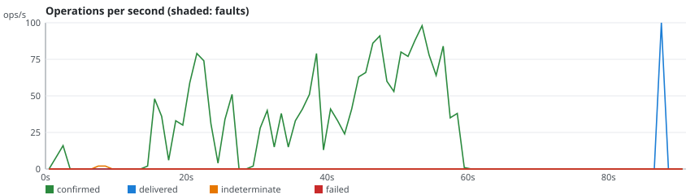
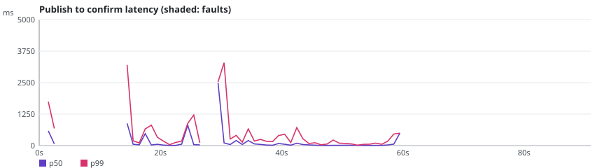

# rmq-verify run r-20261024-112654-2c8a

**Overall: INVALID**

| Setting | Value |
|---|---|
| Scenario | classic-maxlength-control (repetition 2) |
| RabbitMQ | 3.13.7 |
| Queue type | CLASSIC |
| Seed | 20262026 |
| Started | 2026-10-24T11:26:59.153562Z |
| Operations | 4642 |
| confirmTimeoutMs | 5000 |
| consumersPerQueue | 0 |
| durationSeconds | 60 |
| maxLength | 100 |
| payloadBytes | 512 |
| publishers | 4 |
| queues | 1 |
| ratePerPublisher | 30.0 |
| settleSeconds | 20 |

## Fault plan

No fault: control run.

## Verdicts

| Checker | Verdict | Violations | Summary |
|---|---|---|---|
| Availability | VALID | 0 | 99.8% of publishes confirmed, longest unavailability 11000 ms |
| ConfirmedButMissingAfterRecovery | VALID | 0 | 0 of 0 messages exposed to 0 fault(s) missing after recovery |
| DuplicateDeliveries | VALID | 0 | 0 message(s) delivered more than once out of 2071 |
| FifoOrdering | INVALID | 1967 | 0 inversion(s), 1967 gap(s) over 100 first-time deliveries |
| LostMessages | INVALID | 1967 | 1967 lost of 2067 confirmed; 4 indeterminate (0 survived) |
| SplitBrainIndicators | VALID | 0 | 33 probe round(s), 33 outside fault windows |
| UnexpectedMessages | VALID | 0 | 0 unexpected of 100 deliveries |

## Charts

## Anomalies

### FifoOrdering

- **FIFO_GAP** (VIOLATION): confirmed publisher-0#489 in rmqv.r-20261024-112654-2c8a.classic.0 missing while #490 was delivered [evidence: #4047 publisher-0 INVOKE PUBLISH @56.673s; #4050 publisher-0 OK CONFIRM @56.684s; #4350 drain:rmqv.r-20261024-112654-2c8a.classic.0 OK DELIVER @87.062s]
- **FIFO_GAP** (VIOLATION): confirmed publisher-0#488 in rmqv.r-20261024-112654-2c8a.classic.0 missing while #490 was delivered [evidence: #4037 publisher-0 INVOKE PUBLISH @56.616s; #4039 publisher-0 OK CONFIRM @56.625s; #4350 drain:rmqv.r-20261024-112654-2c8a.classic.0 OK DELIVER @87.062s]
- **FIFO_GAP** (VIOLATION): confirmed publisher-0#487 in rmqv.r-20261024-112654-2c8a.classic.0 missing while #490 was delivered [evidence: #4030 publisher-0 INVOKE PUBLISH @56.576s; #4033 publisher-0 OK CONFIRM @56.586s; #4350 drain:rmqv.r-20261024-112654-2c8a.classic.0 OK DELIVER @87.062s]
- **FIFO_GAP** (VIOLATION): confirmed publisher-0#486 in rmqv.r-20261024-112654-2c8a.classic.0 missing while #490 was delivered [evidence: #4023 publisher-0 INVOKE PUBLISH @56.540s; #4026 publisher-0 OK CONFIRM @56.560s; #4350 drain:rmqv.r-20261024-112654-2c8a.classic.0 OK DELIVER @87.062s]
- **FIFO_GAP** (VIOLATION): confirmed publisher-0#485 in rmqv.r-20261024-112654-2c8a.classic.0 missing while #490 was delivered [evidence: #4017 publisher-0 INVOKE PUBLISH @56.524s; #4022 publisher-0 OK CONFIRM @56.540s; #4350 drain:rmqv.r-20261024-112654-2c8a.classic.0 OK DELIVER @87.062s]
- **FIFO_GAP** (VIOLATION): confirmed publisher-0#484 in rmqv.r-20261024-112654-2c8a.classic.0 missing while #490 was delivered [evidence: #4010 publisher-0 INVOKE PUBLISH @56.477s; #4011 publisher-0 OK CONFIRM @56.483s; #4350 drain:rmqv.r-20261024-112654-2c8a.classic.0 OK DELIVER @87.062s]
- **FIFO_GAP** (VIOLATION): confirmed publisher-0#483 in rmqv.r-20261024-112654-2c8a.classic.0 missing while #490 was delivered [evidence: #4006 publisher-0 INVOKE PUBLISH @56.451s; #4008 publisher-0 OK CONFIRM @56.456s; #4350 drain:rmqv.r-20261024-112654-2c8a.classic.0 OK DELIVER @87.062s]
- **FIFO_GAP** (VIOLATION): confirmed publisher-0#482 in rmqv.r-20261024-112654-2c8a.classic.0 missing while #490 was delivered [evidence: #3993 publisher-0 INVOKE PUBLISH @56.404s; #3998 publisher-0 OK CONFIRM @56.413s; #4350 drain:rmqv.r-20261024-112654-2c8a.classic.0 OK DELIVER @87.062s]
- **FIFO_GAP** (VIOLATION): confirmed publisher-0#481 in rmqv.r-20261024-112654-2c8a.classic.0 missing while #490 was delivered [evidence: #3984 publisher-0 INVOKE PUBLISH @56.355s; #3989 publisher-0 OK CONFIRM @56.375s; #4350 drain:rmqv.r-20261024-112654-2c8a.classic.0 OK DELIVER @87.062s]
- **FIFO_GAP** (VIOLATION): confirmed publisher-0#480 in rmqv.r-20261024-112654-2c8a.classic.0 missing while #490 was delivered [evidence: #3978 publisher-0 INVOKE PUBLISH @56.299s; #3981 publisher-0 OK CONFIRM @56.314s; #4350 drain:rmqv.r-20261024-112654-2c8a.classic.0 OK DELIVER @87.062s]
- **FIFO_GAP** (VIOLATION): confirmed publisher-0#479 in rmqv.r-20261024-112654-2c8a.classic.0 missing while #490 was delivered [evidence: #3974 publisher-0 INVOKE PUBLISH @56.269s; #3975 publisher-0 OK CONFIRM @56.281s; #4350 drain:rmqv.r-20261024-112654-2c8a.classic.0 OK DELIVER @87.062s]
- **FIFO_GAP** (VIOLATION): confirmed publisher-0#478 in rmqv.r-20261024-112654-2c8a.classic.0 missing while #490 was delivered [evidence: #3963 publisher-0 INVOKE PUBLISH @56.179s; #3969 publisher-0 OK CONFIRM @56.200s; #4350 drain:rmqv.r-20261024-112654-2c8a.classic.0 OK DELIVER @87.062s]
- **FIFO_GAP** (VIOLATION): confirmed publisher-0#477 in rmqv.r-20261024-112654-2c8a.classic.0 missing while #490 was delivered [evidence: #3958 publisher-0 INVOKE PUBLISH @56.130s; #3962 publisher-0 OK CONFIRM @56.160s; #4350 drain:rmqv.r-20261024-112654-2c8a.classic.0 OK DELIVER @87.062s]
- **FIFO_GAP** (VIOLATION): confirmed publisher-0#476 in rmqv.r-20261024-112654-2c8a.classic.0 missing while #490 was delivered [evidence: #3953 publisher-0 INVOKE PUBLISH @56.075s; #3955 publisher-0 OK CONFIRM @56.110s; #4350 drain:rmqv.r-20261024-112654-2c8a.classic.0 OK DELIVER @87.062s]
- **FIFO_GAP** (VIOLATION): confirmed publisher-0#475 in rmqv.r-20261024-112654-2c8a.classic.0 missing while #490 was delivered [evidence: #3938 publisher-0 INVOKE PUBLISH @56.023s; #3942 publisher-0 OK CONFIRM @56.041s; #4350 drain:rmqv.r-20261024-112654-2c8a.classic.0 OK DELIVER @87.062s]
- **FIFO_GAP** (VIOLATION): confirmed publisher-0#474 in rmqv.r-20261024-112654-2c8a.classic.0 missing while #490 was delivered [evidence: #3921 publisher-0 INVOKE PUBLISH @55.939s; #3924 publisher-0 OK CONFIRM @55.945s; #4350 drain:rmqv.r-20261024-112654-2c8a.classic.0 OK DELIVER @87.062s]
- **FIFO_GAP** (VIOLATION): confirmed publisher-0#473 in rmqv.r-20261024-112654-2c8a.classic.0 missing while #490 was delivered [evidence: #3914 publisher-0 INVOKE PUBLISH @55.905s; #3916 publisher-0 OK CONFIRM @55.912s; #4350 drain:rmqv.r-20261024-112654-2c8a.classic.0 OK DELIVER @87.062s]
- **FIFO_GAP** (VIOLATION): confirmed publisher-0#472 in rmqv.r-20261024-112654-2c8a.classic.0 missing while #490 was delivered [evidence: #3902 publisher-0 INVOKE PUBLISH @55.831s; #3903 publisher-0 OK CONFIRM @55.838s; #4350 drain:rmqv.r-20261024-112654-2c8a.classic.0 OK DELIVER @87.062s]
- **FIFO_GAP** (VIOLATION): confirmed publisher-0#471 in rmqv.r-20261024-112654-2c8a.classic.0 missing while #490 was delivered [evidence: #3894 publisher-0 INVOKE PUBLISH @55.728s; #3895 publisher-0 OK CONFIRM @55.737s; #4350 drain:rmqv.r-20261024-112654-2c8a.classic.0 OK DELIVER @87.062s]
- **FIFO_GAP** (VIOLATION): confirmed publisher-0#470 in rmqv.r-20261024-112654-2c8a.classic.0 missing while #490 was delivered [evidence: #3883 publisher-0 INVOKE PUBLISH @55.674s; #3888 publisher-0 OK CONFIRM @55.706s; #4350 drain:rmqv.r-20261024-112654-2c8a.classic.0 OK DELIVER @87.062s]
- **FIFO_GAP** (VIOLATION): confirmed publisher-0#469 in rmqv.r-20261024-112654-2c8a.classic.0 missing while #490 was delivered [evidence: #3878 publisher-0 INVOKE PUBLISH @55.614s; #3879 publisher-0 OK CONFIRM @55.621s; #4350 drain:rmqv.r-20261024-112654-2c8a.classic.0 OK DELIVER @87.062s]
- **FIFO_GAP** (VIOLATION): confirmed publisher-0#468 in rmqv.r-20261024-112654-2c8a.classic.0 missing while #490 was delivered [evidence: #3860 publisher-0 INVOKE PUBLISH @55.503s; #3861 publisher-0 OK CONFIRM @55.508s; #4350 drain:rmqv.r-20261024-112654-2c8a.classic.0 OK DELIVER @87.062s]
- **FIFO_GAP** (VIOLATION): confirmed publisher-0#467 in rmqv.r-20261024-112654-2c8a.classic.0 missing while #490 was delivered [evidence: #3849 publisher-0 INVOKE PUBLISH @55.387s; #3854 publisher-0 OK CONFIRM @55.436s; #4350 drain:rmqv.r-20261024-112654-2c8a.classic.0 OK DELIVER @87.062s]
- **FIFO_GAP** (VIOLATION): confirmed publisher-0#466 in rmqv.r-20261024-112654-2c8a.classic.0 missing while #490 was delivered [evidence: #3845 publisher-0 INVOKE PUBLISH @55.315s; #3848 publisher-0 OK CONFIRM @55.379s; #4350 drain:rmqv.r-20261024-112654-2c8a.classic.0 OK DELIVER @87.062s]
- **FIFO_GAP** (VIOLATION): confirmed publisher-0#465 in rmqv.r-20261024-112654-2c8a.classic.0 missing while #490 was delivered [evidence: #3840 publisher-0 INVOKE PUBLISH @55.251s; #3842 publisher-0 OK CONFIRM @55.286s; #4350 drain:rmqv.r-20261024-112654-2c8a.classic.0 OK DELIVER @87.062s]
- ... 1942 more in report.json

### LostMessages

- **LOST_CONFIRMED** (VIOLATION): confirmed message publisher-3#0 in rmqv.r-20261024-112654-2c8a.classic.0 was never delivered, queue was drained [evidence: #0 publisher-3 INVOKE PUBLISH @0.000s; #15 publisher-3 OK CONFIRM @1.741s; #4641 drain:rmqv.r-20261024-112654-2c8a.classic.0 OK DRAIN @90.401s]
- **LOST_CONFIRMED** (VIOLATION): confirmed message publisher-0#0 in rmqv.r-20261024-112654-2c8a.classic.0 was never delivered, queue was drained [evidence: #1 publisher-0 INVOKE PUBLISH @0.037s; #11 publisher-0 OK CONFIRM @1.396s; #4641 drain:rmqv.r-20261024-112654-2c8a.classic.0 OK DRAIN @90.401s]
- **LOST_CONFIRMED** (VIOLATION): confirmed message publisher-2#0 in rmqv.r-20261024-112654-2c8a.classic.0 was never delivered, queue was drained [evidence: #2 publisher-2 INVOKE PUBLISH @0.042s; #14 publisher-2 OK CONFIRM @1.689s; #4641 drain:rmqv.r-20261024-112654-2c8a.classic.0 OK DRAIN @90.401s]
- **LOST_CONFIRMED** (VIOLATION): confirmed message publisher-1#0 in rmqv.r-20261024-112654-2c8a.classic.0 was never delivered, queue was drained [evidence: #3 publisher-1 INVOKE PUBLISH @0.047s; #10 publisher-1 OK CONFIRM @1.395s; #4641 drain:rmqv.r-20261024-112654-2c8a.classic.0 OK DRAIN @90.401s]
- **LOST_CONFIRMED** (VIOLATION): confirmed message publisher-0#1 in rmqv.r-20261024-112654-2c8a.classic.0 was never delivered, queue was drained [evidence: #12 publisher-0 INVOKE PUBLISH @1.412s; #21 publisher-0 OK CONFIRM @1.996s; #4641 drain:rmqv.r-20261024-112654-2c8a.classic.0 OK DRAIN @90.401s]
- **LOST_CONFIRMED** (VIOLATION): confirmed message publisher-1#1 in rmqv.r-20261024-112654-2c8a.classic.0 was never delivered, queue was drained [evidence: #13 publisher-1 INVOKE PUBLISH @1.455s; #18 publisher-1 OK CONFIRM @1.905s; #4641 drain:rmqv.r-20261024-112654-2c8a.classic.0 OK DRAIN @90.401s]
- **LOST_CONFIRMED** (VIOLATION): confirmed message publisher-3#1 in rmqv.r-20261024-112654-2c8a.classic.0 was never delivered, queue was drained [evidence: #16 publisher-3 INVOKE PUBLISH @1.779s; #20 publisher-3 OK CONFIRM @1.995s; #4641 drain:rmqv.r-20261024-112654-2c8a.classic.0 OK DRAIN @90.401s]
- **LOST_CONFIRMED** (VIOLATION): confirmed message publisher-2#1 in rmqv.r-20261024-112654-2c8a.classic.0 was never delivered, queue was drained [evidence: #17 publisher-2 INVOKE PUBLISH @1.786s; #22 publisher-2 OK CONFIRM @1.997s; #4641 drain:rmqv.r-20261024-112654-2c8a.classic.0 OK DRAIN @90.401s]
- **LOST_CONFIRMED** (VIOLATION): confirmed message publisher-1#2 in rmqv.r-20261024-112654-2c8a.classic.0 was never delivered, queue was drained [evidence: #19 publisher-1 INVOKE PUBLISH @1.916s; #26 publisher-1 OK CONFIRM @2.476s; #4641 drain:rmqv.r-20261024-112654-2c8a.classic.0 OK DRAIN @90.401s]
- **LOST_CONFIRMED** (VIOLATION): confirmed message publisher-0#2 in rmqv.r-20261024-112654-2c8a.classic.0 was never delivered, queue was drained [evidence: #23 publisher-0 INVOKE PUBLISH @1.999s; #28 publisher-0 OK CONFIRM @2.678s; #4641 drain:rmqv.r-20261024-112654-2c8a.classic.0 OK DRAIN @90.401s]
- **LOST_CONFIRMED** (VIOLATION): confirmed message publisher-2#2 in rmqv.r-20261024-112654-2c8a.classic.0 was never delivered, queue was drained [evidence: #24 publisher-2 INVOKE PUBLISH @2.000s; #30 publisher-2 OK CONFIRM @2.680s; #4641 drain:rmqv.r-20261024-112654-2c8a.classic.0 OK DRAIN @90.401s]
- **LOST_CONFIRMED** (VIOLATION): confirmed message publisher-3#2 in rmqv.r-20261024-112654-2c8a.classic.0 was never delivered, queue was drained [evidence: #25 publisher-3 INVOKE PUBLISH @2.015s; #29 publisher-3 OK CONFIRM @2.678s; #4641 drain:rmqv.r-20261024-112654-2c8a.classic.0 OK DRAIN @90.401s]
- **LOST_CONFIRMED** (VIOLATION): confirmed message publisher-1#3 in rmqv.r-20261024-112654-2c8a.classic.0 was never delivered, queue was drained [evidence: #27 publisher-1 INVOKE PUBLISH @2.556s; #34 publisher-1 OK CONFIRM @2.737s; #4641 drain:rmqv.r-20261024-112654-2c8a.classic.0 OK DRAIN @90.401s]
- **LOST_CONFIRMED** (VIOLATION): confirmed message publisher-0#3 in rmqv.r-20261024-112654-2c8a.classic.0 was never delivered, queue was drained [evidence: #31 publisher-0 INVOKE PUBLISH @2.681s; #35 publisher-0 OK CONFIRM @2.750s; #4641 drain:rmqv.r-20261024-112654-2c8a.classic.0 OK DRAIN @90.401s]
- **LOST_CONFIRMED** (VIOLATION): confirmed message publisher-3#3 in rmqv.r-20261024-112654-2c8a.classic.0 was never delivered, queue was drained [evidence: #32 publisher-3 INVOKE PUBLISH @2.682s; #36 publisher-3 OK CONFIRM @2.750s; #4641 drain:rmqv.r-20261024-112654-2c8a.classic.0 OK DRAIN @90.401s]
- **LOST_CONFIRMED** (VIOLATION): confirmed message publisher-2#3 in rmqv.r-20261024-112654-2c8a.classic.0 was never delivered, queue was drained [evidence: #33 publisher-2 INVOKE PUBLISH @2.703s; #37 publisher-2 OK CONFIRM @2.761s; #4641 drain:rmqv.r-20261024-112654-2c8a.classic.0 OK DRAIN @90.401s]
- **LOST_CONFIRMED** (VIOLATION): confirmed message publisher-2#4 in rmqv.r-20261024-112654-2c8a.classic.0 was never delivered, queue was drained [evidence: #38 publisher-2 INVOKE PUBLISH @2.765s; #43 publisher-2 OK CONFIRM @2.900s; #4641 drain:rmqv.r-20261024-112654-2c8a.classic.0 OK DRAIN @90.401s]
- **LOST_CONFIRMED** (VIOLATION): confirmed message publisher-3#4 in rmqv.r-20261024-112654-2c8a.classic.0 was never delivered, queue was drained [evidence: #39 publisher-3 INVOKE PUBLISH @2.769s; #48 publisher-3 OK CONFIRM @2.919s; #4641 drain:rmqv.r-20261024-112654-2c8a.classic.0 OK DRAIN @90.401s]
- **LOST_CONFIRMED** (VIOLATION): confirmed message publisher-0#4 in rmqv.r-20261024-112654-2c8a.classic.0 was never delivered, queue was drained [evidence: #40 publisher-0 INVOKE PUBLISH @2.820s; #44 publisher-0 OK CONFIRM @2.903s; #4641 drain:rmqv.r-20261024-112654-2c8a.classic.0 OK DRAIN @90.401s]
- **LOST_CONFIRMED** (VIOLATION): confirmed message publisher-1#4 in rmqv.r-20261024-112654-2c8a.classic.0 was never delivered, queue was drained [evidence: #41 publisher-1 INVOKE PUBLISH @2.854s; #42 publisher-1 OK CONFIRM @2.897s; #4641 drain:rmqv.r-20261024-112654-2c8a.classic.0 OK DRAIN @90.401s]
- **LOST_CONFIRMED** (VIOLATION): confirmed message publisher-1#5 in rmqv.r-20261024-112654-2c8a.classic.0 was never delivered, queue was drained [evidence: #45 publisher-1 INVOKE PUBLISH @2.904s; #49 publisher-1 OK CONFIRM @2.926s; #4641 drain:rmqv.r-20261024-112654-2c8a.classic.0 OK DRAIN @90.401s]
- **LOST_CONFIRMED** (VIOLATION): confirmed message publisher-0#5 in rmqv.r-20261024-112654-2c8a.classic.0 was never delivered, queue was drained [evidence: #46 publisher-0 INVOKE PUBLISH @2.906s; #51 publisher-0 OK CONFIRM @2.945s; #4641 drain:rmqv.r-20261024-112654-2c8a.classic.0 OK DRAIN @90.401s]
- **LOST_CONFIRMED** (VIOLATION): confirmed message publisher-2#5 in rmqv.r-20261024-112654-2c8a.classic.0 was never delivered, queue was drained [evidence: #47 publisher-2 INVOKE PUBLISH @2.908s; #53 publisher-2 OK CONFIRM @2.956s; #4641 drain:rmqv.r-20261024-112654-2c8a.classic.0 OK DRAIN @90.401s]
- **LOST_CONFIRMED** (VIOLATION): confirmed message publisher-3#5 in rmqv.r-20261024-112654-2c8a.classic.0 was never delivered, queue was drained [evidence: #50 publisher-3 INVOKE PUBLISH @2.931s; #52 publisher-3 OK CONFIRM @2.955s; #4641 drain:rmqv.r-20261024-112654-2c8a.classic.0 OK DRAIN @90.401s]
- **LOST_CONFIRMED** (VIOLATION): confirmed message publisher-2#7 in rmqv.r-20261024-112654-2c8a.classic.0 was never delivered, queue was drained [evidence: #62 publisher-2 INVOKE PUBLISH @11.753s; #67 publisher-2 OK CONFIRM @14.956s; #4641 drain:rmqv.r-20261024-112654-2c8a.classic.0 OK DRAIN @90.401s]
- ... 1942 more in report.json

## What this run proves

- Proven: FifoOrdering found 1967 violation(s); the evidence operations are in history.jsonl and `rmq-verify check` reproduces them.
- Proven: LostMessages found 1967 violation(s); the evidence operations are in history.jsonl and `rmq-verify check` reproduces them.
- Indeterminate: 4 publish(es) ended without a confirm; 0 of them were delivered anyway, which shows that INFO is not a failure.
- Not proven: a VALID verdict only says that this run, with this plan, did not exhibit the anomaly.
- Limits: one run of 60 s on a 3-node cluster; the seed reproduces the plan and the workload, not the broker's timing; the client reaches every node through Toxiproxy.
