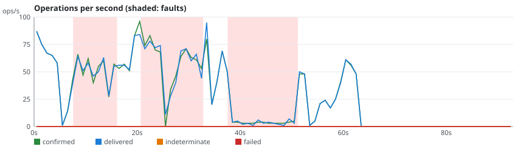
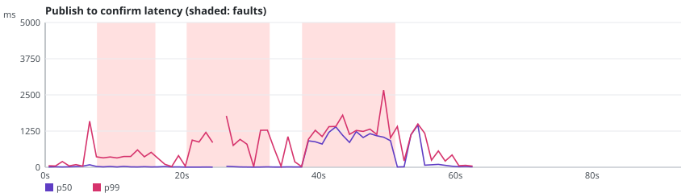
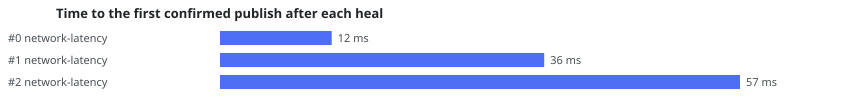

# rmq-verify run r-20261024-114345-3c2a

**Overall: VALID**

| Setting | Value |
|---|---|
| Scenario | quorum-network (repetition 2) |
| RabbitMQ | 3.13.7 |
| Queue type | QUORUM |
| Seed | 20266026 |
| Started | 2026-10-24T11:43:52.755543Z |
| Operations | 12942 |
| confirmTimeoutMs | 5000 |
| consumersPerQueue | 2 |
| durationSeconds | 60 |
| maxLength | 0 |
| payloadBytes | 512 |
| publishers | 4 |
| queues | 1 |
| ratePerPublisher | 30.0 |
| settleSeconds | 20 |

## Fault plan

| # | Nemesis | Start (s) | Duration (s) | Parameters |
|---|---|---|---|---|
| 0 | network-latency | 5.0 | 10.6 | targets=[rabbit3] delayMs=119 jitterMs=29 |
| 1 | network-latency | 20.6 | 11.4 | targets=[rabbit2] delayMs=348 jitterMs=87 |
| 2 | network-latency | 37.3 | 13.7 | targets=[rabbit1] delayMs=403 jitterMs=100 |

## Verdicts

| Checker | Verdict | Violations | Summary |
|---|---|---|---|
| Availability | VALID | 0 | 100.0% of publishes confirmed, longest unavailability 1000 ms |
| ConfirmedButMissingAfterRecovery | VALID | 0 | 0 of 0 messages exposed to 3 fault(s) missing after recovery |
| DuplicateDeliveries | VALID | 0 | 0 message(s) delivered more than once out of 2552 |
| FifoOrdering | VALID | 0 | 0 inversion(s), 0 gap(s) over 2552 first-time deliveries |
| LostMessages | VALID | 0 | 0 lost of 2552 confirmed; 0 indeterminate (0 survived) |
| SplitBrainIndicators | VALID | 0 | 29 probe round(s), 14 outside fault windows |
| UnexpectedMessages | VALID | 0 | 0 unexpected of 2552 deliveries |

## Charts

## Anomalies

None.

## What this run proves

- Not proven: a VALID verdict only says that this run, with this plan, did not exhibit the anomaly.
- Limits: one run of 60 s on a 3-node cluster; the seed reproduces the plan and the workload, not the broker's timing; the client reaches every node through Toxiproxy.
