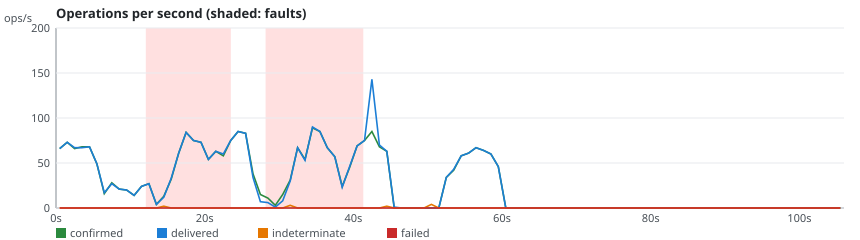
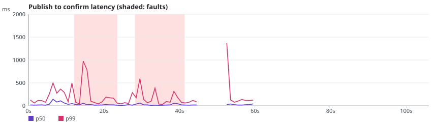

# rmq-verify run r-20261024-113812-3841

**Overall: VALID**

| Setting | Value |
|---|---|
| Scenario | quorum-partitions (repetition 1) |
| RabbitMQ | 3.13.7 |
| Queue type | QUORUM |
| Seed | 20265025 |
| Started | 2026-10-24T11:38:20.818253Z |
| Operations | 13783 |
| confirmTimeoutMs | 5000 |
| consumersPerQueue | 2 |
| durationSeconds | 60 |
| maxLength | 0 |
| payloadBytes | 512 |
| publishers | 4 |
| queues | 1 |
| ratePerPublisher | 30.0 |
| settleSeconds | 20 |

## Fault plan

| # | Nemesis | Start (s) | Duration (s) | Parameters |
|---|---|---|---|---|
| 0 | partition-bridge | 5.0 | 14.3 | targets=[rabbit3, rabbit2, rabbit1] left=1 |
| 1 | partition-bridge | 24.8 | 11.4 | targets=[rabbit1, rabbit3, rabbit2] left=1 |

## Verdicts

| Checker | Verdict | Violations | Summary |
|---|---|---|---|
| Availability | VALID | 0 | 99.6% of publishes confirmed, longest unavailability 7000 ms |
| ConfirmedButMissingAfterRecovery | VALID | 0 | 0 of 16 messages exposed to 2 fault(s) missing after recovery |
| DuplicateDeliveries | VALID | 0 | 31 message(s) delivered more than once out of 2704 |
| FifoOrdering | VALID | 0 | 0 inversion(s), 0 gap(s) over 2699 first-time deliveries |
| LostMessages | VALID | 0 | 0 lost of 2693 confirmed; 11 indeterminate (6 survived) |
| SplitBrainIndicators | VALID | 0 | 35 probe round(s), 22 outside fault windows |
| UnexpectedMessages | VALID | 0 | 0 unexpected of 2730 deliveries |

## Charts

## Anomalies

### DuplicateDeliveries

- **LATE_ORIGINAL_DELIVERY** (NOTE): publisher-3#365 in rmqv.r-20261024-113812-3841.quorum.0 delivered 2 times, the unflagged original arrived after a flagged redelivery [evidence: #10600 consumer-0-1 OK DELIVER @42.877s; #10714 consumer-0-0 OK DELIVER @42.934s]
- **LATE_ORIGINAL_DELIVERY** (NOTE): publisher-3#366 in rmqv.r-20261024-113812-3841.quorum.0 delivered 2 times, the unflagged original arrived after a flagged redelivery [evidence: #10603 consumer-0-1 OK DELIVER @42.880s; #10717 consumer-0-0 OK DELIVER @42.934s]
- **LATE_ORIGINAL_DELIVERY** (NOTE): publisher-3#367 in rmqv.r-20261024-113812-3841.quorum.0 delivered 2 times, the unflagged original arrived after a flagged redelivery [evidence: #10606 consumer-0-1 OK DELIVER @42.880s; #10720 consumer-0-0 OK DELIVER @42.935s]
- **LATE_ORIGINAL_DELIVERY** (NOTE): publisher-3#368 in rmqv.r-20261024-113812-3841.quorum.0 delivered 2 times, the unflagged original arrived after a flagged redelivery [evidence: #10609 consumer-0-1 OK DELIVER @42.880s; #10723 consumer-0-0 OK DELIVER @42.936s]
- **LATE_ORIGINAL_DELIVERY** (NOTE): publisher-3#370 in rmqv.r-20261024-113812-3841.quorum.0 delivered 2 times, the unflagged original arrived after a flagged redelivery [evidence: #10612 consumer-0-1 OK DELIVER @42.881s; #10726 consumer-0-0 OK DELIVER @42.936s]
- **LATE_ORIGINAL_DELIVERY** (NOTE): publisher-3#372 in rmqv.r-20261024-113812-3841.quorum.0 delivered 2 times, the unflagged original arrived after a flagged redelivery [evidence: #10615 consumer-0-1 OK DELIVER @42.881s; #10729 consumer-0-0 OK DELIVER @42.936s]
- **LATE_ORIGINAL_DELIVERY** (NOTE): publisher-3#374 in rmqv.r-20261024-113812-3841.quorum.0 delivered 2 times, the unflagged original arrived after a flagged redelivery [evidence: #10618 consumer-0-1 OK DELIVER @42.881s; #10732 consumer-0-0 OK DELIVER @42.937s]
- **LATE_ORIGINAL_DELIVERY** (NOTE): publisher-3#376 in rmqv.r-20261024-113812-3841.quorum.0 delivered 2 times, the unflagged original arrived after a flagged redelivery [evidence: #10621 consumer-0-1 OK DELIVER @42.881s; #10735 consumer-0-0 OK DELIVER @42.937s]
- **LATE_ORIGINAL_DELIVERY** (NOTE): publisher-3#378 in rmqv.r-20261024-113812-3841.quorum.0 delivered 2 times, the unflagged original arrived after a flagged redelivery [evidence: #10625 consumer-0-1 OK DELIVER @42.886s; #10738 consumer-0-0 OK DELIVER @42.937s]
- **LATE_ORIGINAL_DELIVERY** (NOTE): publisher-3#380 in rmqv.r-20261024-113812-3841.quorum.0 delivered 2 times, the unflagged original arrived after a flagged redelivery [evidence: #10628 consumer-0-1 OK DELIVER @42.886s; #10741 consumer-0-0 OK DELIVER @42.939s]
- **LATE_ORIGINAL_DELIVERY** (NOTE): publisher-3#382 in rmqv.r-20261024-113812-3841.quorum.0 delivered 2 times, the unflagged original arrived after a flagged redelivery [evidence: #10631 consumer-0-1 OK DELIVER @42.886s; #10744 consumer-0-0 OK DELIVER @42.939s]
- **LATE_ORIGINAL_DELIVERY** (NOTE): publisher-3#384 in rmqv.r-20261024-113812-3841.quorum.0 delivered 2 times, the unflagged original arrived after a flagged redelivery [evidence: #10634 consumer-0-1 OK DELIVER @42.886s; #10747 consumer-0-0 OK DELIVER @42.939s]
- **LATE_ORIGINAL_DELIVERY** (NOTE): publisher-3#386 in rmqv.r-20261024-113812-3841.quorum.0 delivered 2 times, the unflagged original arrived after a flagged redelivery [evidence: #10637 consumer-0-1 OK DELIVER @42.888s; #10752 consumer-0-0 OK DELIVER @42.943s]
- **LATE_ORIGINAL_DELIVERY** (NOTE): publisher-3#388 in rmqv.r-20261024-113812-3841.quorum.0 delivered 2 times, the unflagged original arrived after a flagged redelivery [evidence: #10640 consumer-0-1 OK DELIVER @42.889s; #10755 consumer-0-0 OK DELIVER @42.943s]
- **LATE_ORIGINAL_DELIVERY** (NOTE): publisher-3#390 in rmqv.r-20261024-113812-3841.quorum.0 delivered 2 times, the unflagged original arrived after a flagged redelivery [evidence: #10643 consumer-0-1 OK DELIVER @42.889s; #10758 consumer-0-0 OK DELIVER @42.943s]
- **LATE_ORIGINAL_DELIVERY** (NOTE): publisher-3#392 in rmqv.r-20261024-113812-3841.quorum.0 delivered 2 times, the unflagged original arrived after a flagged redelivery [evidence: #10646 consumer-0-1 OK DELIVER @42.889s; #10761 consumer-0-0 OK DELIVER @42.943s]
- **LATE_ORIGINAL_DELIVERY** (NOTE): publisher-3#394 in rmqv.r-20261024-113812-3841.quorum.0 delivered 2 times, the unflagged original arrived after a flagged redelivery [evidence: #10649 consumer-0-1 OK DELIVER @42.889s; #10764 consumer-0-0 OK DELIVER @42.943s]
- **LATE_ORIGINAL_DELIVERY** (NOTE): publisher-3#396 in rmqv.r-20261024-113812-3841.quorum.0 delivered 2 times, the unflagged original arrived after a flagged redelivery [evidence: #10652 consumer-0-1 OK DELIVER @42.889s; #10767 consumer-0-0 OK DELIVER @42.943s]
- **LATE_ORIGINAL_DELIVERY** (NOTE): publisher-3#398 in rmqv.r-20261024-113812-3841.quorum.0 delivered 2 times, the unflagged original arrived after a flagged redelivery [evidence: #10655 consumer-0-1 OK DELIVER @42.890s; #10770 consumer-0-0 OK DELIVER @42.943s]
- **LATE_ORIGINAL_DELIVERY** (NOTE): publisher-3#400 in rmqv.r-20261024-113812-3841.quorum.0 delivered 2 times, the unflagged original arrived after a flagged redelivery [evidence: #10658 consumer-0-1 OK DELIVER @42.890s; #10773 consumer-0-0 OK DELIVER @42.943s]
- **LATE_ORIGINAL_DELIVERY** (NOTE): publisher-3#402 in rmqv.r-20261024-113812-3841.quorum.0 delivered 2 times, the unflagged original arrived after a flagged redelivery [evidence: #10661 consumer-0-1 OK DELIVER @42.890s; #10776 consumer-0-0 OK DELIVER @42.943s]
- **LATE_ORIGINAL_DELIVERY** (NOTE): publisher-3#404 in rmqv.r-20261024-113812-3841.quorum.0 delivered 2 times, the unflagged original arrived after a flagged redelivery [evidence: #10664 consumer-0-1 OK DELIVER @42.890s; #10779 consumer-0-0 OK DELIVER @42.943s]
- **LATE_ORIGINAL_DELIVERY** (NOTE): publisher-3#406 in rmqv.r-20261024-113812-3841.quorum.0 delivered 2 times, the unflagged original arrived after a flagged redelivery [evidence: #10667 consumer-0-1 OK DELIVER @42.890s; #10782 consumer-0-0 OK DELIVER @42.943s]
- **LATE_ORIGINAL_DELIVERY** (NOTE): publisher-3#408 in rmqv.r-20261024-113812-3841.quorum.0 delivered 2 times, the unflagged original arrived after a flagged redelivery [evidence: #10670 consumer-0-1 OK DELIVER @42.890s; #10785 consumer-0-0 OK DELIVER @42.943s]
- **LATE_ORIGINAL_DELIVERY** (NOTE): publisher-3#410 in rmqv.r-20261024-113812-3841.quorum.0 delivered 2 times, the unflagged original arrived after a flagged redelivery [evidence: #10673 consumer-0-1 OK DELIVER @42.890s; #10788 consumer-0-0 OK DELIVER @42.944s]
- ... 6 more in report.json

### FifoOrdering

- **REORDERED_UNCONFIRMED** (NOTE): consumer-0-0 received publisher-2#118 after #229 in rmqv.r-20261024-113812-3841.quorum.0, at least one of them unconfirmed [evidence: #5123 consumer-0-0 OK DELIVER @22.227s; #5135 consumer-0-0 OK DELIVER @22.325s]
- **REORDERED_UNCONFIRMED** (NOTE): consumer-0-1 received publisher-1#116 after #230 in rmqv.r-20261024-113812-3841.quorum.0, at least one of them unconfirmed [evidence: #5118 consumer-0-1 OK DELIVER @22.205s; #5138 consumer-0-1 OK DELIVER @22.333s]

## What this run proves

- Indeterminate: 11 publish(es) ended without a confirm; 6 of them were delivered anyway, which shows that INFO is not a failure.
- Not proven: a VALID verdict only says that this run, with this plan, did not exhibit the anomaly.
- Limits: one run of 60 s on a 3-node cluster; the seed reproduces the plan and the workload, not the broker's timing; the client reaches every node through Toxiproxy.
