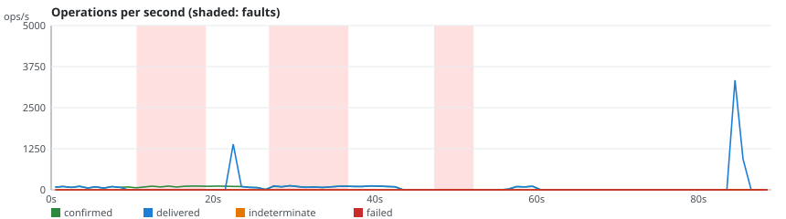
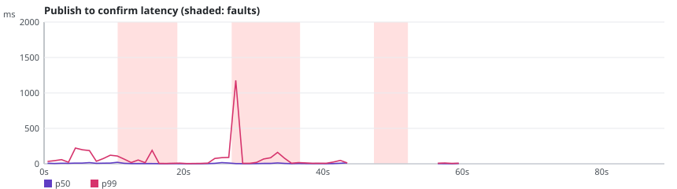
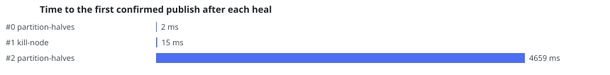

# rmq-verify run r-20261024-123333-4011

**Overall: VALID**

| Setting | Value |
|---|---|
| Scenario | stream-kill-partition (repetition 1) |
| RabbitMQ | 3.13.7 |
| Queue type | STREAM |
| Seed | 20267025 |
| Started | 2026-10-24T12:33:39.649343Z |
| Operations | 17249 |
| confirmTimeoutMs | 5000 |
| consumersPerQueue | 1 |
| durationSeconds | 60 |
| maxLength | 0 |
| payloadBytes | 512 |
| publishers | 4 |
| queues | 1 |
| ratePerPublisher | 30.0 |
| settleSeconds | 20 |

## Fault plan

| # | Nemesis | Start (s) | Duration (s) | Parameters |
|---|---|---|---|---|
| 0 | partition-halves | 5.0 | 13.1 | targets=[rabbit1] |
| 1 | kill-node | 25.8 | 10.6 | targets=[rabbit3] |
| 2 | partition-halves | 41.8 | 9.6 | targets=[rabbit2] |

## Verdicts

| Checker | Verdict | Violations | Summary |
|---|---|---|---|
| Availability | VALID | 0 | 99.9% of publishes confirmed, longest unavailability 13000 ms |
| ConfirmedButMissingAfterRecovery | VALID | 0 | 0 of 3953 messages exposed to 3 fault(s) missing after recovery |
| DuplicateDeliveries | VALID | 0 | 1 message(s) delivered more than once out of 4270 |
| FifoOrdering | VALID | 0 | 0 inversion(s), 0 gap(s) over 8538 first-time deliveries |
| LostMessages | VALID | 0 | 0 lost of 4265 confirmed; 5 indeterminate (4 survived) |
| SplitBrainIndicators | VALID | 0 | 31 probe round(s), 13 outside fault windows |
| UnexpectedMessages | VALID | 0 | 0 unexpected of 8539 deliveries |

## Charts

## Anomalies

### DuplicateDeliveries

- **OFFSET_REPLAY** (NOTE): publisher-2#606 in rmqv.r-20261024-123333-4011.stream.0 read 3 times, replayed by the same reader at one offset [evidence: #7144 consumer-0-0 OK DELIVER @26.011s; #7196 consumer-0-0 OK DELIVER @27.223s; #15342 drain:rmqv.r-20261024-123333-4011.stream.0 OK DELIVER @84.704s]

## What this run proves

- Indeterminate: 5 publish(es) ended without a confirm; 4 of them were delivered anyway, which shows that INFO is not a failure.
- Not proven: a VALID verdict only says that this run, with this plan, did not exhibit the anomaly.
- Limits: one run of 60 s on a 3-node cluster; the seed reproduces the plan and the workload, not the broker's timing; the client reaches every node through Toxiproxy.
