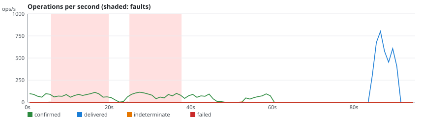
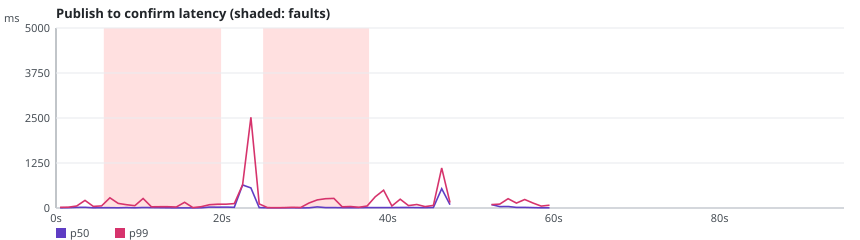
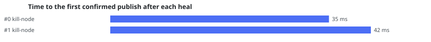

# rmq-verify run r-20261024-115607-3071

**Overall: VALID**

| Setting | Value |
|---|---|
| Scenario | classic-kill (repetition 1) |
| RabbitMQ | 4.4.0 |
| Queue type | CLASSIC |
| Seed | 20263025 |
| Started | 2026-10-24T11:56:16.812133Z |
| Operations | 19285 |
| confirmTimeoutMs | 5000 |
| consumersPerQueue | 0 |
| durationSeconds | 60 |
| maxLength | 0 |
| payloadBytes | 512 |
| publishers | 4 |
| queues | 1 |
| ratePerPublisher | 30.0 |
| settleSeconds | 20 |

## Fault plan

| # | Nemesis | Start (s) | Duration (s) | Parameters |
|---|---|---|---|---|
| 0 | kill-node | 5.0 | 13.1 | targets=[rabbit3] |
| 1 | kill-node | 23.5 | 13.0 | targets=[rabbit2] |

## Verdicts

| Checker | Verdict | Violations | Summary |
|---|---|---|---|
| Availability | VALID | 0 | 99.8% of publishes confirmed, longest unavailability 4000 ms |
| ConfirmedButMissingAfterRecovery | VALID | 0 | 0 of 1740 messages exposed to 2 fault(s) missing after recovery |
| DuplicateDeliveries | VALID | 0 | 0 message(s) delivered more than once out of 3825 |
| FifoOrdering | VALID | 0 | 0 inversion(s), 0 gap(s) over 3821 first-time deliveries |
| LostMessages | VALID | 0 | 0 lost of 3817 confirmed; 8 indeterminate (4 survived) |
| SplitBrainIndicators | VALID | 0 | 37 probe round(s), 19 outside fault windows |
| UnexpectedMessages | VALID | 0 | 0 unexpected of 3821 deliveries |

## Charts

## Anomalies

### SplitBrainIndicators

- **VIEW_DIVERGENCE** (NOTE): round 16: 2 different running-node sets during a fault [evidence: #5584 prober OK PROBE @37.172s; #5586 prober OK PROBE @37.172s]

## What this run proves

- Indeterminate: 8 publish(es) ended without a confirm; 4 of them were delivered anyway, which shows that INFO is not a failure.
- Not proven: a VALID verdict only says that this run, with this plan, did not exhibit the anomaly.
- Limits: one run of 60 s on a 3-node cluster; the seed reproduces the plan and the workload, not the broker's timing; the client reaches every node through Toxiproxy.
