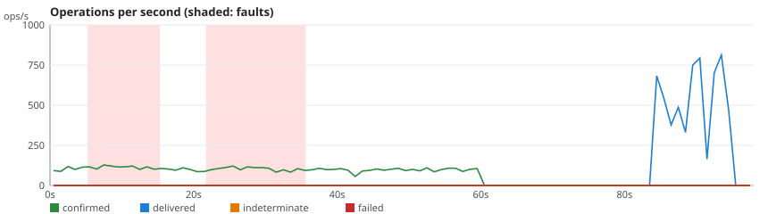
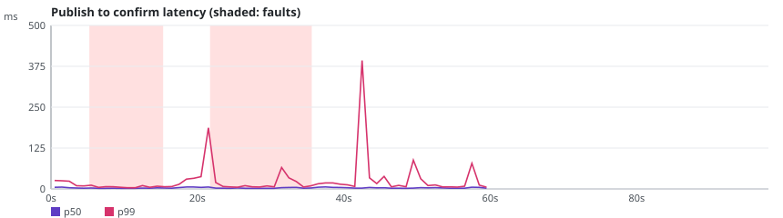

# rmq-verify run r-20261024-115752-3072

**Overall: VALID**

| Setting | Value |
|---|---|
| Scenario | classic-kill (repetition 2) |
| RabbitMQ | 4.4.0 |
| Queue type | CLASSIC |
| Seed | 20263026 |
| Started | 2026-10-24T11:57:55.935993Z |
| Operations | 30795 |
| confirmTimeoutMs | 5000 |
| consumersPerQueue | 0 |
| durationSeconds | 60 |
| maxLength | 0 |
| payloadBytes | 512 |
| publishers | 4 |
| queues | 1 |
| ratePerPublisher | 30.0 |
| settleSeconds | 20 |

## Fault plan

| # | Nemesis | Start (s) | Duration (s) | Parameters |
|---|---|---|---|---|
| 0 | kill-node | 5.0 | 10.1 | targets=[rabbit3] |
| 1 | kill-node | 21.3 | 14.0 | targets=[rabbit3] |

## Verdicts

| Checker | Verdict | Violations | Summary |
|---|---|---|---|
| Availability | VALID | 0 | 100.0% of publishes confirmed, longest unavailability 0 ms |
| ConfirmedButMissingAfterRecovery | VALID | 0 | 0 of 2305 messages exposed to 2 fault(s) missing after recovery |
| DuplicateDeliveries | VALID | 0 | 0 message(s) delivered more than once out of 6115 |
| FifoOrdering | VALID | 0 | 0 inversion(s), 0 gap(s) over 6115 first-time deliveries |
| LostMessages | VALID | 0 | 0 lost of 6115 confirmed; 0 indeterminate (0 survived) |
| SplitBrainIndicators | VALID | 0 | 42 probe round(s), 20 outside fault windows |
| UnexpectedMessages | VALID | 0 | 0 unexpected of 6115 deliveries |

## Charts

## Anomalies

None.

## What this run proves

- Not proven: a VALID verdict only says that this run, with this plan, did not exhibit the anomaly.
- Limits: one run of 60 s on a 3-node cluster; the seed reproduces the plan and the workload, not the broker's timing; the client reaches every node through Toxiproxy.
