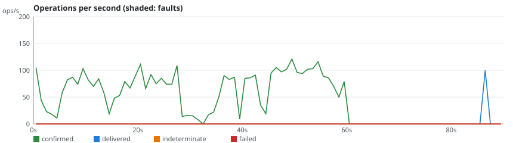
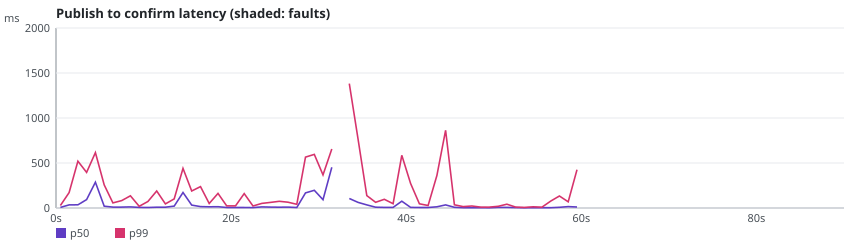

# rmq-verify run r-20261024-115237-2c89

**Overall: INVALID**

| Setting | Value |
|---|---|
| Scenario | classic-maxlength-control (repetition 1) |
| RabbitMQ | 4.4.0 |
| Queue type | CLASSIC |
| Seed | 20262025 |
| Started | 2026-10-24T11:52:44.216154Z |
| Operations | 8686 |
| confirmTimeoutMs | 5000 |
| consumersPerQueue | 0 |
| durationSeconds | 60 |
| maxLength | 100 |
| payloadBytes | 512 |
| publishers | 4 |
| queues | 1 |
| ratePerPublisher | 30.0 |
| settleSeconds | 20 |

## Fault plan

No fault: control run.

## Verdicts

| Checker | Verdict | Violations | Summary |
|---|---|---|---|
| Availability | VALID | 0 | 100.0% of publishes confirmed, longest unavailability 1000 ms |
| ConfirmedButMissingAfterRecovery | VALID | 0 | 0 of 0 messages exposed to 0 fault(s) missing after recovery |
| DuplicateDeliveries | VALID | 0 | 0 message(s) delivered more than once out of 4072 |
| FifoOrdering | INVALID | 3972 | 0 inversion(s), 3972 gap(s) over 100 first-time deliveries |
| LostMessages | INVALID | 3972 | 3972 lost of 4072 confirmed; 0 indeterminate (0 survived) |
| SplitBrainIndicators | VALID | 0 | 40 probe round(s), 40 outside fault windows |
| UnexpectedMessages | VALID | 0 | 0 unexpected of 100 deliveries |

## Charts

## Anomalies

### FifoOrdering

- **FIFO_GAP** (VIOLATION): confirmed publisher-3#959 in rmqv.r-20261024-115237-2c89.classic.0 missing while #960 was delivered [evidence: #8083 publisher-3 INVOKE PUBLISH @58.192s; #8085 publisher-3 OK CONFIRM @58.198s; #8385 drain:rmqv.r-20261024-115237-2c89.classic.0 OK DELIVER @86.556s]
- **FIFO_GAP** (VIOLATION): confirmed publisher-3#958 in rmqv.r-20261024-115237-2c89.classic.0 missing while #960 was delivered [evidence: #8079 publisher-3 INVOKE PUBLISH @58.170s; #8082 publisher-3 OK CONFIRM @58.192s; #8385 drain:rmqv.r-20261024-115237-2c89.classic.0 OK DELIVER @86.556s]
- **FIFO_GAP** (VIOLATION): confirmed publisher-3#957 in rmqv.r-20261024-115237-2c89.classic.0 missing while #960 was delivered [evidence: #8064 publisher-3 INVOKE PUBLISH @58.115s; #8072 publisher-3 OK CONFIRM @58.139s; #8385 drain:rmqv.r-20261024-115237-2c89.classic.0 OK DELIVER @86.556s]
- **FIFO_GAP** (VIOLATION): confirmed publisher-3#956 in rmqv.r-20261024-115237-2c89.classic.0 missing while #960 was delivered [evidence: #8058 publisher-3 INVOKE PUBLISH @58.069s; #8061 publisher-3 OK CONFIRM @58.088s; #8385 drain:rmqv.r-20261024-115237-2c89.classic.0 OK DELIVER @86.556s]
- **FIFO_GAP** (VIOLATION): confirmed publisher-3#955 in rmqv.r-20261024-115237-2c89.classic.0 missing while #960 was delivered [evidence: #8052 publisher-3 INVOKE PUBLISH @58.045s; #8055 publisher-3 OK CONFIRM @58.057s; #8385 drain:rmqv.r-20261024-115237-2c89.classic.0 OK DELIVER @86.556s]
- **FIFO_GAP** (VIOLATION): confirmed publisher-3#954 in rmqv.r-20261024-115237-2c89.classic.0 missing while #960 was delivered [evidence: #8042 publisher-3 INVOKE PUBLISH @58.010s; #8044 publisher-3 OK CONFIRM @58.016s; #8385 drain:rmqv.r-20261024-115237-2c89.classic.0 OK DELIVER @86.556s]
- **FIFO_GAP** (VIOLATION): confirmed publisher-3#953 in rmqv.r-20261024-115237-2c89.classic.0 missing while #960 was delivered [evidence: #8033 publisher-3 INVOKE PUBLISH @57.925s; #8038 publisher-3 OK CONFIRM @57.962s; #8385 drain:rmqv.r-20261024-115237-2c89.classic.0 OK DELIVER @86.556s]
- **FIFO_GAP** (VIOLATION): confirmed publisher-3#952 in rmqv.r-20261024-115237-2c89.classic.0 missing while #960 was delivered [evidence: #8026 publisher-3 INVOKE PUBLISH @57.820s; #8030 publisher-3 OK CONFIRM @57.902s; #8385 drain:rmqv.r-20261024-115237-2c89.classic.0 OK DELIVER @86.556s]
- **FIFO_GAP** (VIOLATION): confirmed publisher-3#951 in rmqv.r-20261024-115237-2c89.classic.0 missing while #960 was delivered [evidence: #8021 publisher-3 INVOKE PUBLISH @57.797s; #8023 publisher-3 OK CONFIRM @57.814s; #8385 drain:rmqv.r-20261024-115237-2c89.classic.0 OK DELIVER @86.556s]
- **FIFO_GAP** (VIOLATION): confirmed publisher-3#950 in rmqv.r-20261024-115237-2c89.classic.0 missing while #960 was delivered [evidence: #8014 publisher-3 INVOKE PUBLISH @57.752s; #8019 publisher-3 OK CONFIRM @57.783s; #8385 drain:rmqv.r-20261024-115237-2c89.classic.0 OK DELIVER @86.556s]
- **FIFO_GAP** (VIOLATION): confirmed publisher-3#949 in rmqv.r-20261024-115237-2c89.classic.0 missing while #960 was delivered [evidence: #8005 publisher-3 INVOKE PUBLISH @57.635s; #8011 publisher-3 OK CONFIRM @57.743s; #8385 drain:rmqv.r-20261024-115237-2c89.classic.0 OK DELIVER @86.556s]
- **FIFO_GAP** (VIOLATION): confirmed publisher-3#948 in rmqv.r-20261024-115237-2c89.classic.0 missing while #960 was delivered [evidence: #7995 publisher-3 INVOKE PUBLISH @57.474s; #8000 publisher-3 OK CONFIRM @57.497s; #8385 drain:rmqv.r-20261024-115237-2c89.classic.0 OK DELIVER @86.556s]
- **FIFO_GAP** (VIOLATION): confirmed publisher-3#947 in rmqv.r-20261024-115237-2c89.classic.0 missing while #960 was delivered [evidence: #7989 publisher-3 INVOKE PUBLISH @57.438s; #7991 publisher-3 OK CONFIRM @57.444s; #8385 drain:rmqv.r-20261024-115237-2c89.classic.0 OK DELIVER @86.556s]
- **FIFO_GAP** (VIOLATION): confirmed publisher-3#946 in rmqv.r-20261024-115237-2c89.classic.0 missing while #960 was delivered [evidence: #7984 publisher-3 INVOKE PUBLISH @57.365s; #7985 publisher-3 OK CONFIRM @57.374s; #8385 drain:rmqv.r-20261024-115237-2c89.classic.0 OK DELIVER @86.556s]
- **FIFO_GAP** (VIOLATION): confirmed publisher-3#945 in rmqv.r-20261024-115237-2c89.classic.0 missing while #960 was delivered [evidence: #7982 publisher-3 INVOKE PUBLISH @57.337s; #7983 publisher-3 OK CONFIRM @57.341s; #8385 drain:rmqv.r-20261024-115237-2c89.classic.0 OK DELIVER @86.556s]
- **FIFO_GAP** (VIOLATION): confirmed publisher-3#944 in rmqv.r-20261024-115237-2c89.classic.0 missing while #960 was delivered [evidence: #7974 publisher-3 INVOKE PUBLISH @57.299s; #7977 publisher-3 OK CONFIRM @57.305s; #8385 drain:rmqv.r-20261024-115237-2c89.classic.0 OK DELIVER @86.556s]
- **FIFO_GAP** (VIOLATION): confirmed publisher-3#943 in rmqv.r-20261024-115237-2c89.classic.0 missing while #960 was delivered [evidence: #7970 publisher-3 INVOKE PUBLISH @57.279s; #7971 publisher-3 OK CONFIRM @57.283s; #8385 drain:rmqv.r-20261024-115237-2c89.classic.0 OK DELIVER @86.556s]
- **FIFO_GAP** (VIOLATION): confirmed publisher-3#942 in rmqv.r-20261024-115237-2c89.classic.0 missing while #960 was delivered [evidence: #7966 publisher-3 INVOKE PUBLISH @57.267s; #7968 publisher-3 OK CONFIRM @57.274s; #8385 drain:rmqv.r-20261024-115237-2c89.classic.0 OK DELIVER @86.556s]
- **FIFO_GAP** (VIOLATION): confirmed publisher-3#941 in rmqv.r-20261024-115237-2c89.classic.0 missing while #960 was delivered [evidence: #7958 publisher-3 INVOKE PUBLISH @57.235s; #7959 publisher-3 OK CONFIRM @57.242s; #8385 drain:rmqv.r-20261024-115237-2c89.classic.0 OK DELIVER @86.556s]
- **FIFO_GAP** (VIOLATION): confirmed publisher-3#940 in rmqv.r-20261024-115237-2c89.classic.0 missing while #960 was delivered [evidence: #7952 publisher-3 INVOKE PUBLISH @57.219s; #7956 publisher-3 OK CONFIRM @57.226s; #8385 drain:rmqv.r-20261024-115237-2c89.classic.0 OK DELIVER @86.556s]
- **FIFO_GAP** (VIOLATION): confirmed publisher-3#939 in rmqv.r-20261024-115237-2c89.classic.0 missing while #960 was delivered [evidence: #7945 publisher-3 INVOKE PUBLISH @57.193s; #7947 publisher-3 OK CONFIRM @57.198s; #8385 drain:rmqv.r-20261024-115237-2c89.classic.0 OK DELIVER @86.556s]
- **FIFO_GAP** (VIOLATION): confirmed publisher-3#938 in rmqv.r-20261024-115237-2c89.classic.0 missing while #960 was delivered [evidence: #7925 publisher-3 INVOKE PUBLISH @57.097s; #7927 publisher-3 OK CONFIRM @57.106s; #8385 drain:rmqv.r-20261024-115237-2c89.classic.0 OK DELIVER @86.556s]
- **FIFO_GAP** (VIOLATION): confirmed publisher-3#937 in rmqv.r-20261024-115237-2c89.classic.0 missing while #960 was delivered [evidence: #7922 publisher-3 INVOKE PUBLISH @57.079s; #7923 publisher-3 OK CONFIRM @57.082s; #8385 drain:rmqv.r-20261024-115237-2c89.classic.0 OK DELIVER @86.556s]
- **FIFO_GAP** (VIOLATION): confirmed publisher-3#936 in rmqv.r-20261024-115237-2c89.classic.0 missing while #960 was delivered [evidence: #7913 publisher-3 INVOKE PUBLISH @57.050s; #7916 publisher-3 OK CONFIRM @57.057s; #8385 drain:rmqv.r-20261024-115237-2c89.classic.0 OK DELIVER @86.556s]
- **FIFO_GAP** (VIOLATION): confirmed publisher-3#935 in rmqv.r-20261024-115237-2c89.classic.0 missing while #960 was delivered [evidence: #7906 publisher-3 INVOKE PUBLISH @57.032s; #7908 publisher-3 OK CONFIRM @57.042s; #8385 drain:rmqv.r-20261024-115237-2c89.classic.0 OK DELIVER @86.556s]
- ... 3947 more in report.json

### LostMessages

- **LOST_CONFIRMED** (VIOLATION): confirmed message publisher-3#0 in rmqv.r-20261024-115237-2c89.classic.0 was never delivered, queue was drained [evidence: #6 publisher-3 INVOKE PUBLISH @0.020s; #9 publisher-3 OK CONFIRM @0.047s; #8685 drain:rmqv.r-20261024-115237-2c89.classic.0 OK DRAIN @89.996s]
- **LOST_CONFIRMED** (VIOLATION): confirmed message publisher-1#0 in rmqv.r-20261024-115237-2c89.classic.0 was never delivered, queue was drained [evidence: #7 publisher-1 INVOKE PUBLISH @0.020s; #11 publisher-1 OK CONFIRM @0.058s; #8685 drain:rmqv.r-20261024-115237-2c89.classic.0 OK DRAIN @89.996s]
- **LOST_CONFIRMED** (VIOLATION): confirmed message publisher-0#0 in rmqv.r-20261024-115237-2c89.classic.0 was never delivered, queue was drained [evidence: #8 publisher-0 INVOKE PUBLISH @0.045s; #12 publisher-0 OK CONFIRM @0.058s; #8685 drain:rmqv.r-20261024-115237-2c89.classic.0 OK DRAIN @89.996s]
- **LOST_CONFIRMED** (VIOLATION): confirmed message publisher-3#1 in rmqv.r-20261024-115237-2c89.classic.0 was never delivered, queue was drained [evidence: #10 publisher-3 INVOKE PUBLISH @0.052s; #14 publisher-3 OK CONFIRM @0.073s; #8685 drain:rmqv.r-20261024-115237-2c89.classic.0 OK DRAIN @89.996s]
- **LOST_CONFIRMED** (VIOLATION): confirmed message publisher-2#0 in rmqv.r-20261024-115237-2c89.classic.0 was never delivered, queue was drained [evidence: #13 publisher-2 INVOKE PUBLISH @0.064s; #15 publisher-2 OK CONFIRM @0.078s; #8685 drain:rmqv.r-20261024-115237-2c89.classic.0 OK DRAIN @89.996s]
- **LOST_CONFIRMED** (VIOLATION): confirmed message publisher-2#1 in rmqv.r-20261024-115237-2c89.classic.0 was never delivered, queue was drained [evidence: #16 publisher-2 INVOKE PUBLISH @0.083s; #21 publisher-2 OK CONFIRM @0.091s; #8685 drain:rmqv.r-20261024-115237-2c89.classic.0 OK DRAIN @89.996s]
- **LOST_CONFIRMED** (VIOLATION): confirmed message publisher-0#1 in rmqv.r-20261024-115237-2c89.classic.0 was never delivered, queue was drained [evidence: #17 publisher-0 INVOKE PUBLISH @0.083s; #20 publisher-0 OK CONFIRM @0.091s; #8685 drain:rmqv.r-20261024-115237-2c89.classic.0 OK DRAIN @89.996s]
- **LOST_CONFIRMED** (VIOLATION): confirmed message publisher-3#2 in rmqv.r-20261024-115237-2c89.classic.0 was never delivered, queue was drained [evidence: #18 publisher-3 INVOKE PUBLISH @0.087s; #23 publisher-3 OK CONFIRM @0.094s; #8685 drain:rmqv.r-20261024-115237-2c89.classic.0 OK DRAIN @89.996s]
- **LOST_CONFIRMED** (VIOLATION): confirmed message publisher-1#1 in rmqv.r-20261024-115237-2c89.classic.0 was never delivered, queue was drained [evidence: #19 publisher-1 INVOKE PUBLISH @0.090s; #22 publisher-1 OK CONFIRM @0.093s; #8685 drain:rmqv.r-20261024-115237-2c89.classic.0 OK DRAIN @89.996s]
- **LOST_CONFIRMED** (VIOLATION): confirmed message publisher-3#3 in rmqv.r-20261024-115237-2c89.classic.0 was never delivered, queue was drained [evidence: #24 publisher-3 INVOKE PUBLISH @0.095s; #25 publisher-3 OK CONFIRM @0.101s; #8685 drain:rmqv.r-20261024-115237-2c89.classic.0 OK DRAIN @89.996s]
- **LOST_CONFIRMED** (VIOLATION): confirmed message publisher-3#4 in rmqv.r-20261024-115237-2c89.classic.0 was never delivered, queue was drained [evidence: #26 publisher-3 INVOKE PUBLISH @0.105s; #30 publisher-3 OK CONFIRM @0.116s; #8685 drain:rmqv.r-20261024-115237-2c89.classic.0 OK DRAIN @89.996s]
- **LOST_CONFIRMED** (VIOLATION): confirmed message publisher-0#2 in rmqv.r-20261024-115237-2c89.classic.0 was never delivered, queue was drained [evidence: #27 publisher-0 INVOKE PUBLISH @0.106s; #28 publisher-0 OK CONFIRM @0.110s; #8685 drain:rmqv.r-20261024-115237-2c89.classic.0 OK DRAIN @89.996s]
- **LOST_CONFIRMED** (VIOLATION): confirmed message publisher-0#3 in rmqv.r-20261024-115237-2c89.classic.0 was never delivered, queue was drained [evidence: #29 publisher-0 INVOKE PUBLISH @0.113s; #31 publisher-0 OK CONFIRM @0.119s; #8685 drain:rmqv.r-20261024-115237-2c89.classic.0 OK DRAIN @89.996s]
- **LOST_CONFIRMED** (VIOLATION): confirmed message publisher-3#5 in rmqv.r-20261024-115237-2c89.classic.0 was never delivered, queue was drained [evidence: #32 publisher-3 INVOKE PUBLISH @0.123s; #33 publisher-3 OK CONFIRM @0.127s; #8685 drain:rmqv.r-20261024-115237-2c89.classic.0 OK DRAIN @89.996s]
- **LOST_CONFIRMED** (VIOLATION): confirmed message publisher-2#2 in rmqv.r-20261024-115237-2c89.classic.0 was never delivered, queue was drained [evidence: #34 publisher-2 INVOKE PUBLISH @0.131s; #36 publisher-2 OK CONFIRM @0.137s; #8685 drain:rmqv.r-20261024-115237-2c89.classic.0 OK DRAIN @89.996s]
- **LOST_CONFIRMED** (VIOLATION): confirmed message publisher-3#6 in rmqv.r-20261024-115237-2c89.classic.0 was never delivered, queue was drained [evidence: #35 publisher-3 INVOKE PUBLISH @0.137s; #37 publisher-3 OK CONFIRM @0.144s; #8685 drain:rmqv.r-20261024-115237-2c89.classic.0 OK DRAIN @89.996s]
- **LOST_CONFIRMED** (VIOLATION): confirmed message publisher-2#3 in rmqv.r-20261024-115237-2c89.classic.0 was never delivered, queue was drained [evidence: #38 publisher-2 INVOKE PUBLISH @0.144s; #41 publisher-2 OK CONFIRM @0.152s; #8685 drain:rmqv.r-20261024-115237-2c89.classic.0 OK DRAIN @89.996s]
- **LOST_CONFIRMED** (VIOLATION): confirmed message publisher-1#2 in rmqv.r-20261024-115237-2c89.classic.0 was never delivered, queue was drained [evidence: #39 publisher-1 INVOKE PUBLISH @0.147s; #42 publisher-1 OK CONFIRM @0.152s; #8685 drain:rmqv.r-20261024-115237-2c89.classic.0 OK DRAIN @89.996s]
- **LOST_CONFIRMED** (VIOLATION): confirmed message publisher-3#7 in rmqv.r-20261024-115237-2c89.classic.0 was never delivered, queue was drained [evidence: #40 publisher-3 INVOKE PUBLISH @0.149s; #43 publisher-3 OK CONFIRM @0.154s; #8685 drain:rmqv.r-20261024-115237-2c89.classic.0 OK DRAIN @89.996s]
- **LOST_CONFIRMED** (VIOLATION): confirmed message publisher-3#8 in rmqv.r-20261024-115237-2c89.classic.0 was never delivered, queue was drained [evidence: #44 publisher-3 INVOKE PUBLISH @0.158s; #45 publisher-3 OK CONFIRM @0.161s; #8685 drain:rmqv.r-20261024-115237-2c89.classic.0 OK DRAIN @89.996s]
- **LOST_CONFIRMED** (VIOLATION): confirmed message publisher-1#3 in rmqv.r-20261024-115237-2c89.classic.0 was never delivered, queue was drained [evidence: #46 publisher-1 INVOKE PUBLISH @0.165s; #48 publisher-1 OK CONFIRM @0.175s; #8685 drain:rmqv.r-20261024-115237-2c89.classic.0 OK DRAIN @89.996s]
- **LOST_CONFIRMED** (VIOLATION): confirmed message publisher-2#4 in rmqv.r-20261024-115237-2c89.classic.0 was never delivered, queue was drained [evidence: #47 publisher-2 INVOKE PUBLISH @0.174s; #50 publisher-2 OK CONFIRM @0.178s; #8685 drain:rmqv.r-20261024-115237-2c89.classic.0 OK DRAIN @89.996s]
- **LOST_CONFIRMED** (VIOLATION): confirmed message publisher-1#4 in rmqv.r-20261024-115237-2c89.classic.0 was never delivered, queue was drained [evidence: #49 publisher-1 INVOKE PUBLISH @0.177s; #51 publisher-1 OK CONFIRM @0.181s; #8685 drain:rmqv.r-20261024-115237-2c89.classic.0 OK DRAIN @89.996s]
- **LOST_CONFIRMED** (VIOLATION): confirmed message publisher-0#4 in rmqv.r-20261024-115237-2c89.classic.0 was never delivered, queue was drained [evidence: #52 publisher-0 INVOKE PUBLISH @0.188s; #55 publisher-0 OK CONFIRM @0.195s; #8685 drain:rmqv.r-20261024-115237-2c89.classic.0 OK DRAIN @89.996s]
- **LOST_CONFIRMED** (VIOLATION): confirmed message publisher-2#5 in rmqv.r-20261024-115237-2c89.classic.0 was never delivered, queue was drained [evidence: #53 publisher-2 INVOKE PUBLISH @0.190s; #56 publisher-2 OK CONFIRM @0.199s; #8685 drain:rmqv.r-20261024-115237-2c89.classic.0 OK DRAIN @89.996s]
- ... 3947 more in report.json

## What this run proves

- Proven: FifoOrdering found 3972 violation(s); the evidence operations are in history.jsonl and `rmq-verify check` reproduces them.
- Proven: LostMessages found 3972 violation(s); the evidence operations are in history.jsonl and `rmq-verify check` reproduces them.
- Not proven: a VALID verdict only says that this run, with this plan, did not exhibit the anomaly.
- Limits: one run of 60 s on a 3-node cluster; the seed reproduces the plan and the workload, not the broker's timing; the client reaches every node through Toxiproxy.
