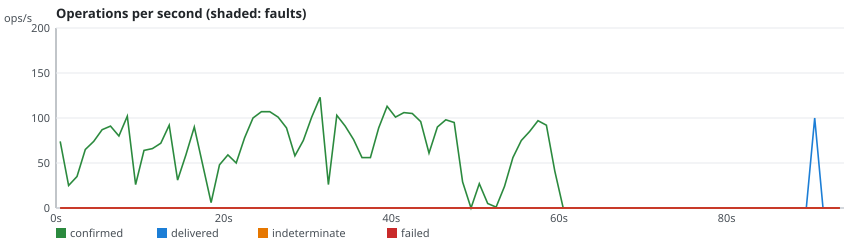
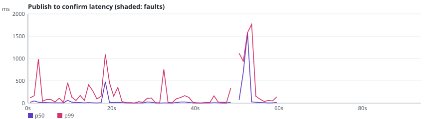

# rmq-verify run r-20261024-115416-2c8a

**Overall: INVALID**

| Setting | Value |
|---|---|
| Scenario | classic-maxlength-control (repetition 2) |
| RabbitMQ | 4.4.0 |
| Queue type | CLASSIC |
| Seed | 20262026 |
| Started | 2026-10-24T11:54:30.646813Z |
| Operations | 8890 |
| confirmTimeoutMs | 5000 |
| consumersPerQueue | 0 |
| durationSeconds | 60 |
| maxLength | 100 |
| payloadBytes | 512 |
| publishers | 4 |
| queues | 1 |
| ratePerPublisher | 30.0 |
| settleSeconds | 20 |

## Fault plan

No fault: control run.

## Verdicts

| Checker | Verdict | Violations | Summary |
|---|---|---|---|
| Availability | VALID | 0 | 100.0% of publishes confirmed, longest unavailability 1000 ms |
| ConfirmedButMissingAfterRecovery | VALID | 0 | 0 of 0 messages exposed to 0 fault(s) missing after recovery |
| DuplicateDeliveries | VALID | 0 | 0 message(s) delivered more than once out of 4177 |
| FifoOrdering | INVALID | 4077 | 0 inversion(s), 4077 gap(s) over 100 first-time deliveries |
| LostMessages | INVALID | 4077 | 4077 lost of 4177 confirmed; 0 indeterminate (0 survived) |
| SplitBrainIndicators | VALID | 0 | 39 probe round(s), 39 outside fault windows |
| UnexpectedMessages | VALID | 0 | 0 unexpected of 100 deliveries |

## Charts

## Anomalies

### FifoOrdering

- **FIFO_GAP** (VIOLATION): confirmed publisher-3#1001 in rmqv.r-20261024-115416-2c8a.classic.0 missing while #1002 was delivered [evidence: #8307 publisher-3 INVOKE PUBLISH @58.285s; #8309 publisher-3 OK CONFIRM @58.289s; #8592 drain:rmqv.r-20261024-115416-2c8a.classic.0 OK DELIVER @90.035s]
- **FIFO_GAP** (VIOLATION): confirmed publisher-3#1000 in rmqv.r-20261024-115416-2c8a.classic.0 missing while #1002 was delivered [evidence: #8286 publisher-3 INVOKE PUBLISH @58.186s; #8288 publisher-3 OK CONFIRM @58.193s; #8592 drain:rmqv.r-20261024-115416-2c8a.classic.0 OK DELIVER @90.035s]
- **FIFO_GAP** (VIOLATION): confirmed publisher-3#999 in rmqv.r-20261024-115416-2c8a.classic.0 missing while #1002 was delivered [evidence: #8284 publisher-3 INVOKE PUBLISH @58.178s; #8285 publisher-3 OK CONFIRM @58.183s; #8592 drain:rmqv.r-20261024-115416-2c8a.classic.0 OK DELIVER @90.035s]
- **FIFO_GAP** (VIOLATION): confirmed publisher-3#998 in rmqv.r-20261024-115416-2c8a.classic.0 missing while #1002 was delivered [evidence: #8278 publisher-3 INVOKE PUBLISH @58.148s; #8279 publisher-3 OK CONFIRM @58.151s; #8592 drain:rmqv.r-20261024-115416-2c8a.classic.0 OK DELIVER @90.035s]
- **FIFO_GAP** (VIOLATION): confirmed publisher-3#997 in rmqv.r-20261024-115416-2c8a.classic.0 missing while #1002 was delivered [evidence: #8273 publisher-3 INVOKE PUBLISH @58.118s; #8275 publisher-3 OK CONFIRM @58.122s; #8592 drain:rmqv.r-20261024-115416-2c8a.classic.0 OK DELIVER @90.035s]
- **FIFO_GAP** (VIOLATION): confirmed publisher-3#996 in rmqv.r-20261024-115416-2c8a.classic.0 missing while #1002 was delivered [evidence: #8266 publisher-3 INVOKE PUBLISH @58.089s; #8267 publisher-3 OK CONFIRM @58.095s; #8592 drain:rmqv.r-20261024-115416-2c8a.classic.0 OK DELIVER @90.035s]
- **FIFO_GAP** (VIOLATION): confirmed publisher-3#995 in rmqv.r-20261024-115416-2c8a.classic.0 missing while #1002 was delivered [evidence: #8249 publisher-3 INVOKE PUBLISH @58.058s; #8258 publisher-3 OK CONFIRM @58.063s; #8592 drain:rmqv.r-20261024-115416-2c8a.classic.0 OK DELIVER @90.035s]
- **FIFO_GAP** (VIOLATION): confirmed publisher-3#994 in rmqv.r-20261024-115416-2c8a.classic.0 missing while #1002 was delivered [evidence: #8246 publisher-3 INVOKE PUBLISH @58.037s; #8247 publisher-3 OK CONFIRM @58.050s; #8592 drain:rmqv.r-20261024-115416-2c8a.classic.0 OK DELIVER @90.035s]
- **FIFO_GAP** (VIOLATION): confirmed publisher-3#993 in rmqv.r-20261024-115416-2c8a.classic.0 missing while #1002 was delivered [evidence: #8241 publisher-3 INVOKE PUBLISH @58.024s; #8245 publisher-3 OK CONFIRM @58.034s; #8592 drain:rmqv.r-20261024-115416-2c8a.classic.0 OK DELIVER @90.035s]
- **FIFO_GAP** (VIOLATION): confirmed publisher-3#992 in rmqv.r-20261024-115416-2c8a.classic.0 missing while #1002 was delivered [evidence: #8234 publisher-3 INVOKE PUBLISH @57.979s; #8235 publisher-3 OK CONFIRM @57.982s; #8592 drain:rmqv.r-20261024-115416-2c8a.classic.0 OK DELIVER @90.035s]
- **FIFO_GAP** (VIOLATION): confirmed publisher-3#991 in rmqv.r-20261024-115416-2c8a.classic.0 missing while #1002 was delivered [evidence: #8225 publisher-3 INVOKE PUBLISH @57.932s; #8227 publisher-3 OK CONFIRM @57.936s; #8592 drain:rmqv.r-20261024-115416-2c8a.classic.0 OK DELIVER @90.035s]
- **FIFO_GAP** (VIOLATION): confirmed publisher-3#990 in rmqv.r-20261024-115416-2c8a.classic.0 missing while #1002 was delivered [evidence: #8222 publisher-3 INVOKE PUBLISH @57.916s; #8223 publisher-3 OK CONFIRM @57.920s; #8592 drain:rmqv.r-20261024-115416-2c8a.classic.0 OK DELIVER @90.035s]
- **FIFO_GAP** (VIOLATION): confirmed publisher-3#989 in rmqv.r-20261024-115416-2c8a.classic.0 missing while #1002 was delivered [evidence: #8210 publisher-3 INVOKE PUBLISH @57.867s; #8211 publisher-3 OK CONFIRM @57.870s; #8592 drain:rmqv.r-20261024-115416-2c8a.classic.0 OK DELIVER @90.035s]
- **FIFO_GAP** (VIOLATION): confirmed publisher-3#988 in rmqv.r-20261024-115416-2c8a.classic.0 missing while #1002 was delivered [evidence: #8207 publisher-3 INVOKE PUBLISH @57.860s; #8209 publisher-3 OK CONFIRM @57.862s; #8592 drain:rmqv.r-20261024-115416-2c8a.classic.0 OK DELIVER @90.035s]
- **FIFO_GAP** (VIOLATION): confirmed publisher-3#987 in rmqv.r-20261024-115416-2c8a.classic.0 missing while #1002 was delivered [evidence: #8198 publisher-3 INVOKE PUBLISH @57.839s; #8199 publisher-3 OK CONFIRM @57.843s; #8592 drain:rmqv.r-20261024-115416-2c8a.classic.0 OK DELIVER @90.035s]
- **FIFO_GAP** (VIOLATION): confirmed publisher-3#986 in rmqv.r-20261024-115416-2c8a.classic.0 missing while #1002 was delivered [evidence: #8194 publisher-3 INVOKE PUBLISH @57.817s; #8196 publisher-3 OK CONFIRM @57.821s; #8592 drain:rmqv.r-20261024-115416-2c8a.classic.0 OK DELIVER @90.035s]
- **FIFO_GAP** (VIOLATION): confirmed publisher-3#985 in rmqv.r-20261024-115416-2c8a.classic.0 missing while #1002 was delivered [evidence: #8178 publisher-3 INVOKE PUBLISH @57.697s; #8179 publisher-3 OK CONFIRM @57.700s; #8592 drain:rmqv.r-20261024-115416-2c8a.classic.0 OK DELIVER @90.035s]
- **FIFO_GAP** (VIOLATION): confirmed publisher-3#984 in rmqv.r-20261024-115416-2c8a.classic.0 missing while #1002 was delivered [evidence: #8171 publisher-3 INVOKE PUBLISH @57.684s; #8172 publisher-3 OK CONFIRM @57.687s; #8592 drain:rmqv.r-20261024-115416-2c8a.classic.0 OK DELIVER @90.035s]
- **FIFO_GAP** (VIOLATION): confirmed publisher-3#983 in rmqv.r-20261024-115416-2c8a.classic.0 missing while #1002 was delivered [evidence: #8163 publisher-3 INVOKE PUBLISH @57.626s; #8165 publisher-3 OK CONFIRM @57.628s; #8592 drain:rmqv.r-20261024-115416-2c8a.classic.0 OK DELIVER @90.035s]
- **FIFO_GAP** (VIOLATION): confirmed publisher-3#982 in rmqv.r-20261024-115416-2c8a.classic.0 missing while #1002 was delivered [evidence: #8160 publisher-3 INVOKE PUBLISH @57.614s; #8161 publisher-3 OK CONFIRM @57.617s; #8592 drain:rmqv.r-20261024-115416-2c8a.classic.0 OK DELIVER @90.035s]
- **FIFO_GAP** (VIOLATION): confirmed publisher-3#981 in rmqv.r-20261024-115416-2c8a.classic.0 missing while #1002 was delivered [evidence: #8156 publisher-3 INVOKE PUBLISH @57.603s; #8157 publisher-3 OK CONFIRM @57.605s; #8592 drain:rmqv.r-20261024-115416-2c8a.classic.0 OK DELIVER @90.035s]
- **FIFO_GAP** (VIOLATION): confirmed publisher-3#980 in rmqv.r-20261024-115416-2c8a.classic.0 missing while #1002 was delivered [evidence: #8148 publisher-3 INVOKE PUBLISH @57.575s; #8151 publisher-3 OK CONFIRM @57.578s; #8592 drain:rmqv.r-20261024-115416-2c8a.classic.0 OK DELIVER @90.035s]
- **FIFO_GAP** (VIOLATION): confirmed publisher-3#979 in rmqv.r-20261024-115416-2c8a.classic.0 missing while #1002 was delivered [evidence: #8134 publisher-3 INVOKE PUBLISH @57.504s; #8136 publisher-3 OK CONFIRM @57.510s; #8592 drain:rmqv.r-20261024-115416-2c8a.classic.0 OK DELIVER @90.035s]
- **FIFO_GAP** (VIOLATION): confirmed publisher-3#978 in rmqv.r-20261024-115416-2c8a.classic.0 missing while #1002 was delivered [evidence: #8132 publisher-3 INVOKE PUBLISH @57.487s; #8133 publisher-3 OK CONFIRM @57.492s; #8592 drain:rmqv.r-20261024-115416-2c8a.classic.0 OK DELIVER @90.035s]
- **FIFO_GAP** (VIOLATION): confirmed publisher-3#977 in rmqv.r-20261024-115416-2c8a.classic.0 missing while #1002 was delivered [evidence: #8124 publisher-3 INVOKE PUBLISH @57.445s; #8125 publisher-3 OK CONFIRM @57.449s; #8592 drain:rmqv.r-20261024-115416-2c8a.classic.0 OK DELIVER @90.035s]
- ... 4052 more in report.json

### LostMessages

- **LOST_CONFIRMED** (VIOLATION): confirmed message publisher-0#0 in rmqv.r-20261024-115416-2c8a.classic.0 was never delivered, queue was drained [evidence: #0 publisher-0 INVOKE PUBLISH @0.000s; #11 publisher-0 OK CONFIRM @0.118s; #8889 drain:rmqv.r-20261024-115416-2c8a.classic.0 OK DRAIN @93.809s]
- **LOST_CONFIRMED** (VIOLATION): confirmed message publisher-1#0 in rmqv.r-20261024-115416-2c8a.classic.0 was never delivered, queue was drained [evidence: #1 publisher-1 INVOKE PUBLISH @0.023s; #10 publisher-1 OK CONFIRM @0.115s; #8889 drain:rmqv.r-20261024-115416-2c8a.classic.0 OK DRAIN @93.809s]
- **LOST_CONFIRMED** (VIOLATION): confirmed message publisher-2#0 in rmqv.r-20261024-115416-2c8a.classic.0 was never delivered, queue was drained [evidence: #2 publisher-2 INVOKE PUBLISH @0.023s; #13 publisher-2 OK CONFIRM @0.119s; #8889 drain:rmqv.r-20261024-115416-2c8a.classic.0 OK DRAIN @93.809s]
- **LOST_CONFIRMED** (VIOLATION): confirmed message publisher-3#0 in rmqv.r-20261024-115416-2c8a.classic.0 was never delivered, queue was drained [evidence: #3 publisher-3 INVOKE PUBLISH @0.024s; #12 publisher-3 OK CONFIRM @0.119s; #8889 drain:rmqv.r-20261024-115416-2c8a.classic.0 OK DRAIN @93.809s]
- **LOST_CONFIRMED** (VIOLATION): confirmed message publisher-0#1 in rmqv.r-20261024-115416-2c8a.classic.0 was never delivered, queue was drained [evidence: #14 publisher-0 INVOKE PUBLISH @0.129s; #15 publisher-0 OK CONFIRM @0.148s; #8889 drain:rmqv.r-20261024-115416-2c8a.classic.0 OK DRAIN @93.809s]
- **LOST_CONFIRMED** (VIOLATION): confirmed message publisher-0#2 in rmqv.r-20261024-115416-2c8a.classic.0 was never delivered, queue was drained [evidence: #16 publisher-0 INVOKE PUBLISH @0.149s; #18 publisher-0 OK CONFIRM @0.168s; #8889 drain:rmqv.r-20261024-115416-2c8a.classic.0 OK DRAIN @93.809s]
- **LOST_CONFIRMED** (VIOLATION): confirmed message publisher-3#1 in rmqv.r-20261024-115416-2c8a.classic.0 was never delivered, queue was drained [evidence: #17 publisher-3 INVOKE PUBLISH @0.152s; #21 publisher-3 OK CONFIRM @0.181s; #8889 drain:rmqv.r-20261024-115416-2c8a.classic.0 OK DRAIN @93.809s]
- **LOST_CONFIRMED** (VIOLATION): confirmed message publisher-1#1 in rmqv.r-20261024-115416-2c8a.classic.0 was never delivered, queue was drained [evidence: #19 publisher-1 INVOKE PUBLISH @0.174s; #24 publisher-1 OK CONFIRM @0.200s; #8889 drain:rmqv.r-20261024-115416-2c8a.classic.0 OK DRAIN @93.809s]
- **LOST_CONFIRMED** (VIOLATION): confirmed message publisher-0#3 in rmqv.r-20261024-115416-2c8a.classic.0 was never delivered, queue was drained [evidence: #20 publisher-0 INVOKE PUBLISH @0.175s; #22 publisher-0 OK CONFIRM @0.187s; #8889 drain:rmqv.r-20261024-115416-2c8a.classic.0 OK DRAIN @93.809s]
- **LOST_CONFIRMED** (VIOLATION): confirmed message publisher-3#2 in rmqv.r-20261024-115416-2c8a.classic.0 was never delivered, queue was drained [evidence: #23 publisher-3 INVOKE PUBLISH @0.198s; #26 publisher-3 OK CONFIRM @0.211s; #8889 drain:rmqv.r-20261024-115416-2c8a.classic.0 OK DRAIN @93.809s]
- **LOST_CONFIRMED** (VIOLATION): confirmed message publisher-1#2 in rmqv.r-20261024-115416-2c8a.classic.0 was never delivered, queue was drained [evidence: #25 publisher-1 INVOKE PUBLISH @0.203s; #29 publisher-1 OK CONFIRM @0.219s; #8889 drain:rmqv.r-20261024-115416-2c8a.classic.0 OK DRAIN @93.809s]
- **LOST_CONFIRMED** (VIOLATION): confirmed message publisher-3#3 in rmqv.r-20261024-115416-2c8a.classic.0 was never delivered, queue was drained [evidence: #27 publisher-3 INVOKE PUBLISH @0.213s; #30 publisher-3 OK CONFIRM @0.221s; #8889 drain:rmqv.r-20261024-115416-2c8a.classic.0 OK DRAIN @93.809s]
- **LOST_CONFIRMED** (VIOLATION): confirmed message publisher-2#1 in rmqv.r-20261024-115416-2c8a.classic.0 was never delivered, queue was drained [evidence: #28 publisher-2 INVOKE PUBLISH @0.216s; #31 publisher-2 OK CONFIRM @0.224s; #8889 drain:rmqv.r-20261024-115416-2c8a.classic.0 OK DRAIN @93.809s]
- **LOST_CONFIRMED** (VIOLATION): confirmed message publisher-2#2 in rmqv.r-20261024-115416-2c8a.classic.0 was never delivered, queue was drained [evidence: #32 publisher-2 INVOKE PUBLISH @0.227s; #36 publisher-2 OK CONFIRM @0.238s; #8889 drain:rmqv.r-20261024-115416-2c8a.classic.0 OK DRAIN @93.809s]
- **LOST_CONFIRMED** (VIOLATION): confirmed message publisher-0#4 in rmqv.r-20261024-115416-2c8a.classic.0 was never delivered, queue was drained [evidence: #33 publisher-0 INVOKE PUBLISH @0.230s; #35 publisher-0 OK CONFIRM @0.237s; #8889 drain:rmqv.r-20261024-115416-2c8a.classic.0 OK DRAIN @93.809s]
- **LOST_CONFIRMED** (VIOLATION): confirmed message publisher-3#4 in rmqv.r-20261024-115416-2c8a.classic.0 was never delivered, queue was drained [evidence: #34 publisher-3 INVOKE PUBLISH @0.235s; #38 publisher-3 OK CONFIRM @0.245s; #8889 drain:rmqv.r-20261024-115416-2c8a.classic.0 OK DRAIN @93.809s]
- **LOST_CONFIRMED** (VIOLATION): confirmed message publisher-0#5 in rmqv.r-20261024-115416-2c8a.classic.0 was never delivered, queue was drained [evidence: #37 publisher-0 INVOKE PUBLISH @0.240s; #41 publisher-0 OK CONFIRM @0.264s; #8889 drain:rmqv.r-20261024-115416-2c8a.classic.0 OK DRAIN @93.809s]
- **LOST_CONFIRMED** (VIOLATION): confirmed message publisher-3#5 in rmqv.r-20261024-115416-2c8a.classic.0 was never delivered, queue was drained [evidence: #39 publisher-3 INVOKE PUBLISH @0.261s; #42 publisher-3 OK CONFIRM @0.268s; #8889 drain:rmqv.r-20261024-115416-2c8a.classic.0 OK DRAIN @93.809s]
- **LOST_CONFIRMED** (VIOLATION): confirmed message publisher-2#3 in rmqv.r-20261024-115416-2c8a.classic.0 was never delivered, queue was drained [evidence: #40 publisher-2 INVOKE PUBLISH @0.262s; #43 publisher-2 OK CONFIRM @0.269s; #8889 drain:rmqv.r-20261024-115416-2c8a.classic.0 OK DRAIN @93.809s]
- **LOST_CONFIRMED** (VIOLATION): confirmed message publisher-2#4 in rmqv.r-20261024-115416-2c8a.classic.0 was never delivered, queue was drained [evidence: #44 publisher-2 INVOKE PUBLISH @0.270s; #45 publisher-2 OK CONFIRM @0.285s; #8889 drain:rmqv.r-20261024-115416-2c8a.classic.0 OK DRAIN @93.809s]
- **LOST_CONFIRMED** (VIOLATION): confirmed message publisher-2#5 in rmqv.r-20261024-115416-2c8a.classic.0 was never delivered, queue was drained [evidence: #46 publisher-2 INVOKE PUBLISH @0.293s; #49 publisher-2 OK CONFIRM @0.304s; #8889 drain:rmqv.r-20261024-115416-2c8a.classic.0 OK DRAIN @93.809s]
- **LOST_CONFIRMED** (VIOLATION): confirmed message publisher-1#3 in rmqv.r-20261024-115416-2c8a.classic.0 was never delivered, queue was drained [evidence: #47 publisher-1 INVOKE PUBLISH @0.296s; #50 publisher-1 OK CONFIRM @0.304s; #8889 drain:rmqv.r-20261024-115416-2c8a.classic.0 OK DRAIN @93.809s]
- **LOST_CONFIRMED** (VIOLATION): confirmed message publisher-3#6 in rmqv.r-20261024-115416-2c8a.classic.0 was never delivered, queue was drained [evidence: #48 publisher-3 INVOKE PUBLISH @0.297s; #51 publisher-3 OK CONFIRM @0.305s; #8889 drain:rmqv.r-20261024-115416-2c8a.classic.0 OK DRAIN @93.809s]
- **LOST_CONFIRMED** (VIOLATION): confirmed message publisher-2#6 in rmqv.r-20261024-115416-2c8a.classic.0 was never delivered, queue was drained [evidence: #52 publisher-2 INVOKE PUBLISH @0.306s; #55 publisher-2 OK CONFIRM @0.327s; #8889 drain:rmqv.r-20261024-115416-2c8a.classic.0 OK DRAIN @93.809s]
- **LOST_CONFIRMED** (VIOLATION): confirmed message publisher-0#6 in rmqv.r-20261024-115416-2c8a.classic.0 was never delivered, queue was drained [evidence: #53 publisher-0 INVOKE PUBLISH @0.321s; #56 publisher-0 OK CONFIRM @0.337s; #8889 drain:rmqv.r-20261024-115416-2c8a.classic.0 OK DRAIN @93.809s]
- ... 4052 more in report.json

## What this run proves

- Proven: FifoOrdering found 4077 violation(s); the evidence operations are in history.jsonl and `rmq-verify check` reproduces them.
- Proven: LostMessages found 4077 violation(s); the evidence operations are in history.jsonl and `rmq-verify check` reproduces them.
- Not proven: a VALID verdict only says that this run, with this plan, did not exhibit the anomaly.
- Limits: one run of 60 s on a 3-node cluster; the seed reproduces the plan and the workload, not the broker's timing; the client reaches every node through Toxiproxy.
