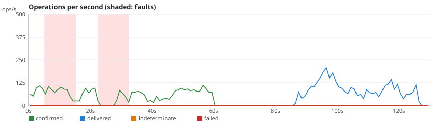
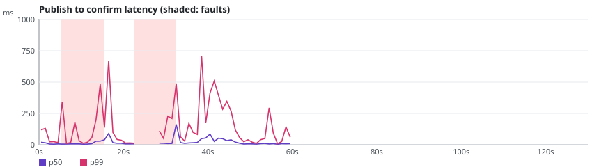

# rmq-verify run r-20261024-115935-3459

**Overall: VALID**

| Setting | Value |
|---|---|
| Scenario | quorum-kill-pause (repetition 1) |
| RabbitMQ | 4.4.0 |
| Queue type | QUORUM |
| Seed | 20264025 |
| Started | 2026-10-24T11:59:45.771484Z |
| Operations | 18944 |
| confirmTimeoutMs | 5000 |
| consumersPerQueue | 0 |
| durationSeconds | 60 |
| maxLength | 0 |
| payloadBytes | 512 |
| publishers | 4 |
| queues | 1 |
| ratePerPublisher | 30.0 |
| settleSeconds | 20 |

## Fault plan

| # | Nemesis | Start (s) | Duration (s) | Parameters |
|---|---|---|---|---|
| 0 | kill-node | 5.0 | 8.7 | targets=[rabbit3] |
| 1 | kill-node | 22.4 | 9.0 | targets=[rabbit2] |

## Verdicts

| Checker | Verdict | Violations | Summary |
|---|---|---|---|
| Availability | VALID | 0 | 99.8% of publishes confirmed, longest unavailability 5000 ms |
| ConfirmedButMissingAfterRecovery | VALID | 0 | 0 of 1695 messages exposed to 2 fault(s) missing after recovery |
| DuplicateDeliveries | VALID | 0 | 0 message(s) delivered more than once out of 3749 |
| FifoOrdering | VALID | 0 | 0 inversion(s), 0 gap(s) over 3746 first-time deliveries |
| LostMessages | VALID | 0 | 0 lost of 3740 confirmed; 9 indeterminate (6 survived) |
| SplitBrainIndicators | VALID | 0 | 41 probe round(s), 22 outside fault windows |
| UnexpectedMessages | VALID | 0 | 0 unexpected of 3746 deliveries |

## Charts

## Anomalies

None.

## What this run proves

- Indeterminate: 9 publish(es) ended without a confirm; 6 of them were delivered anyway, which shows that INFO is not a failure.
- Not proven: a VALID verdict only says that this run, with this plan, did not exhibit the anomaly.
- Limits: one run of 60 s on a 3-node cluster; the seed reproduces the plan and the workload, not the broker's timing; the client reaches every node through Toxiproxy.
