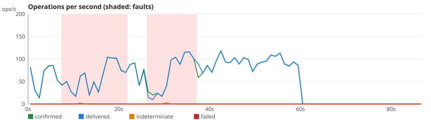
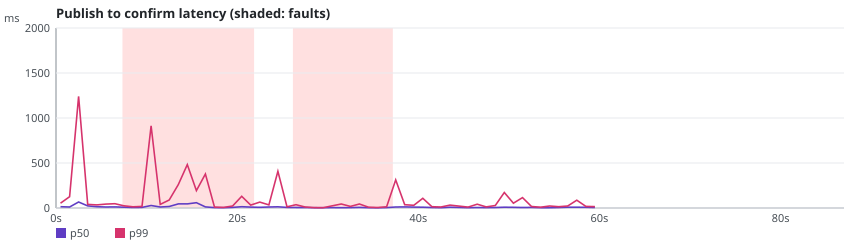
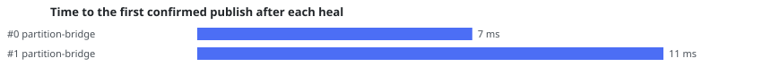

# rmq-verify run r-20261024-120421-3841

**Overall: VALID**

| Setting | Value |
|---|---|
| Scenario | quorum-partitions (repetition 1) |
| RabbitMQ | 4.4.0 |
| Queue type | QUORUM |
| Seed | 20265025 |
| Started | 2026-10-24T12:04:26.005262Z |
| Operations | 22489 |
| confirmTimeoutMs | 5000 |
| consumersPerQueue | 2 |
| durationSeconds | 60 |
| maxLength | 0 |
| payloadBytes | 512 |
| publishers | 4 |
| queues | 1 |
| ratePerPublisher | 30.0 |
| settleSeconds | 20 |

## Fault plan

| # | Nemesis | Start (s) | Duration (s) | Parameters |
|---|---|---|---|---|
| 0 | partition-bridge | 5.0 | 14.3 | targets=[rabbit3, rabbit2, rabbit1] left=1 |
| 1 | partition-bridge | 24.8 | 11.4 | targets=[rabbit1, rabbit3, rabbit2] left=1 |

## Verdicts

| Checker | Verdict | Violations | Summary |
|---|---|---|---|
| Availability | VALID | 0 | 99.9% of publishes confirmed, longest unavailability 0 ms |
| ConfirmedButMissingAfterRecovery | VALID | 0 | 0 of 9 messages exposed to 2 fault(s) missing after recovery |
| DuplicateDeliveries | VALID | 0 | 0 message(s) delivered more than once out of 4463 |
| FifoOrdering | VALID | 0 | 0 inversion(s), 0 gap(s) over 4461 first-time deliveries |
| LostMessages | VALID | 0 | 0 lost of 4458 confirmed; 5 indeterminate (3 survived) |
| SplitBrainIndicators | VALID | 0 | 31 probe round(s), 18 outside fault windows |
| UnexpectedMessages | VALID | 0 | 0 unexpected of 4461 deliveries |

## Charts

## Anomalies

### SplitBrainIndicators

- **VIEW_DIVERGENCE** (NOTE): round 5: 3 different running-node sets during a fault [evidence: #6885 prober OK PROBE @22.762s; #6887 prober OK PROBE @22.763s; #6889 prober OK PROBE @22.766s]

## What this run proves

- Indeterminate: 5 publish(es) ended without a confirm; 3 of them were delivered anyway, which shows that INFO is not a failure.
- Not proven: a VALID verdict only says that this run, with this plan, did not exhibit the anomaly.
- Limits: one run of 60 s on a 3-node cluster; the seed reproduces the plan and the workload, not the broker's timing; the client reaches every node through Toxiproxy.
