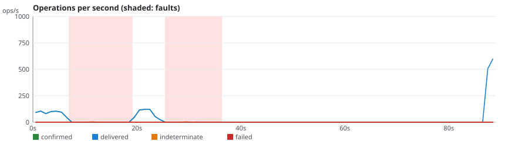
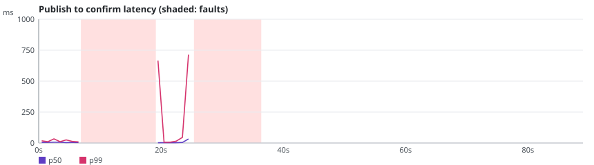

# rmq-verify run r-20261024-121354-4012

**Overall: VALID**

| Setting | Value |
|---|---|
| Scenario | stream-kill-partition (repetition 2) |
| RabbitMQ | 4.4.0 |
| Queue type | STREAM |
| Seed | 20267026 |
| Started | 2026-10-24T12:14:04.571946Z |
| Operations | 4631 |
| confirmTimeoutMs | 5000 |
| consumersPerQueue | 1 |
| durationSeconds | 60 |
| maxLength | 0 |
| payloadBytes | 512 |
| publishers | 4 |
| queues | 1 |
| ratePerPublisher | 30.0 |
| settleSeconds | 20 |

## Fault plan

| # | Nemesis | Start (s) | Duration (s) | Parameters |
|---|---|---|---|---|
| 0 | partition-halves | 5.0 | 13.2 | targets=[rabbit1] |
| 1 | kill-node | 24.1 | 10.9 | targets=[rabbit1] |

## Verdicts

| Checker | Verdict | Violations | Summary |
|---|---|---|---|
| Availability | VALID | 0 | 99.3% of publishes confirmed, longest unavailability 12000 ms |
| ConfirmedButMissingAfterRecovery | VALID | 0 | 0 of 1102 messages exposed to 2 fault(s) missing after recovery |
| DuplicateDeliveries | VALID | 0 | 1 message(s) delivered more than once out of 1110 |
| FifoOrdering | VALID | 0 | 0 inversion(s), 0 gap(s) over 2214 first-time deliveries |
| LostMessages | VALID | 0 | 0 lost of 1102 confirmed; 8 indeterminate (5 survived) |
| SplitBrainIndicators | VALID | 0 | 37 probe round(s), 21 outside fault windows |
| UnexpectedMessages | VALID | 0 | 0 unexpected of 2215 deliveries |

## Charts

## Anomalies

### Availability

- **RECOVERY_UNOBSERVED** (NOTE): fault #1 (kill-node): no publish attempted after the heal [evidence: #3389 nemesis OK NEMESIS_STOP @36.395s]

### DuplicateDeliveries

- **OFFSET_REPLAY** (NOTE): publisher-0#281 in rmqv.r-20261024-121354-4012.stream.0 read 3 times, replayed by the same reader at one offset [evidence: #3358 consumer-0-0 OK DELIVER @24.715s; #3379 consumer-0-0 OK DELIVER @31.138s; #4628 drain:rmqv.r-20261024-121354-4012.stream.0 OK DELIVER @88.321s]

## What this run proves

- Indeterminate: 8 publish(es) ended without a confirm; 5 of them were delivered anyway, which shows that INFO is not a failure.
- Not proven: a VALID verdict only says that this run, with this plan, did not exhibit the anomaly.
- Limits: one run of 60 s on a 3-node cluster; the seed reproduces the plan and the workload, not the broker's timing; the client reaches every node through Toxiproxy.
